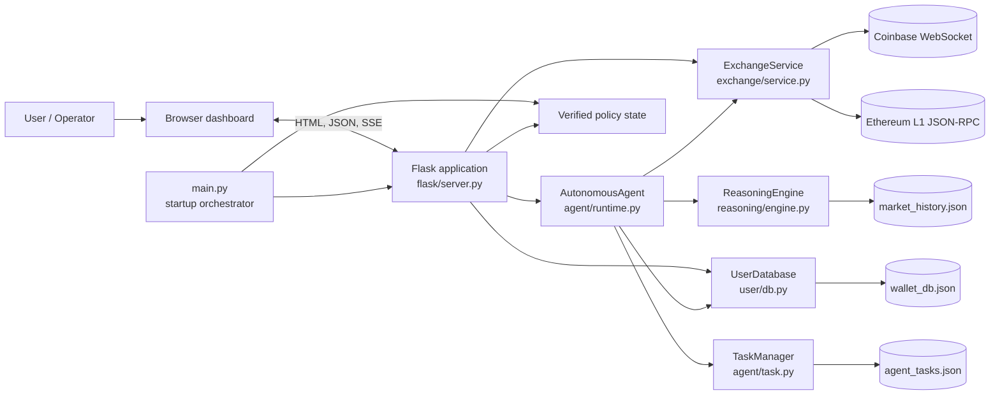
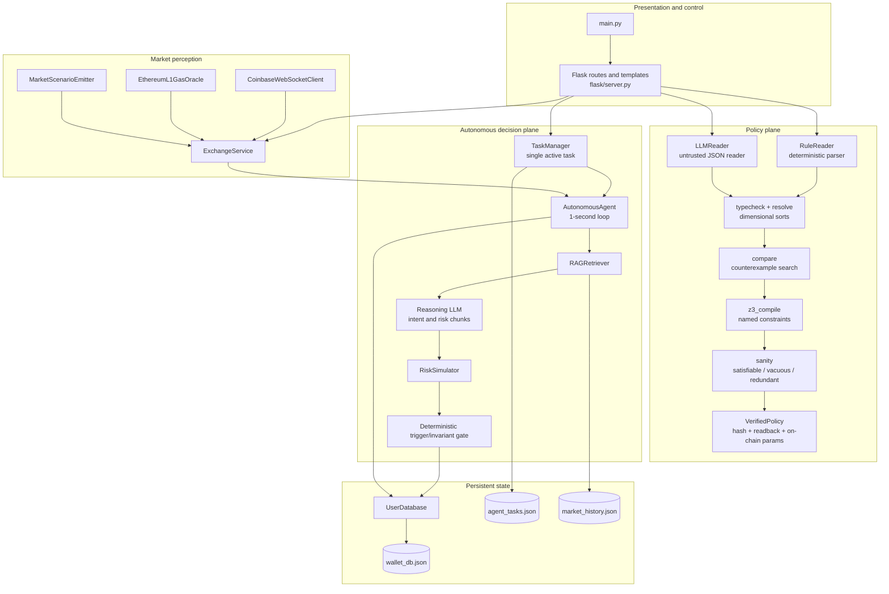
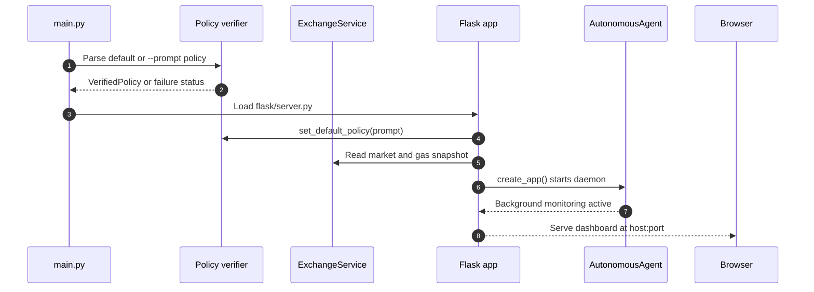
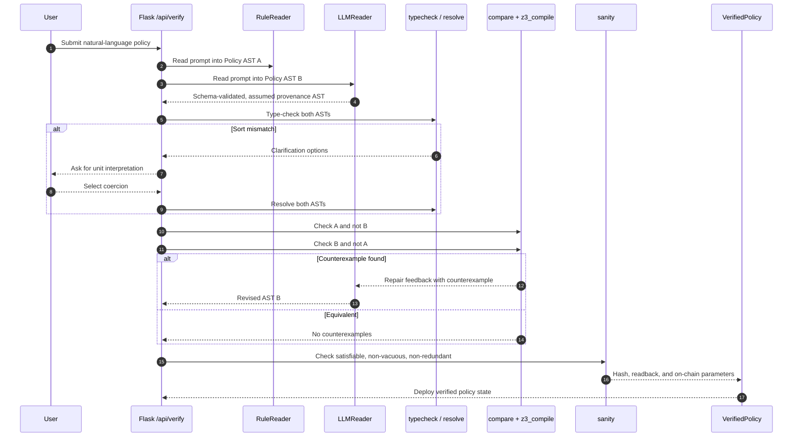
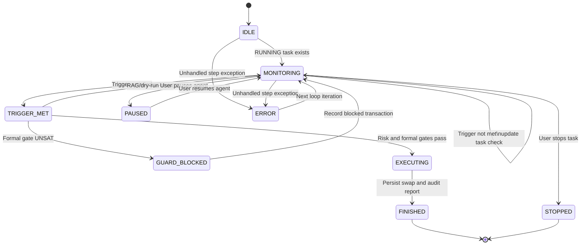
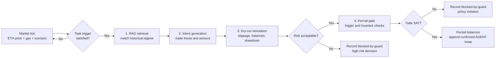
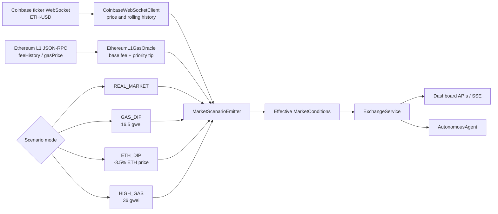
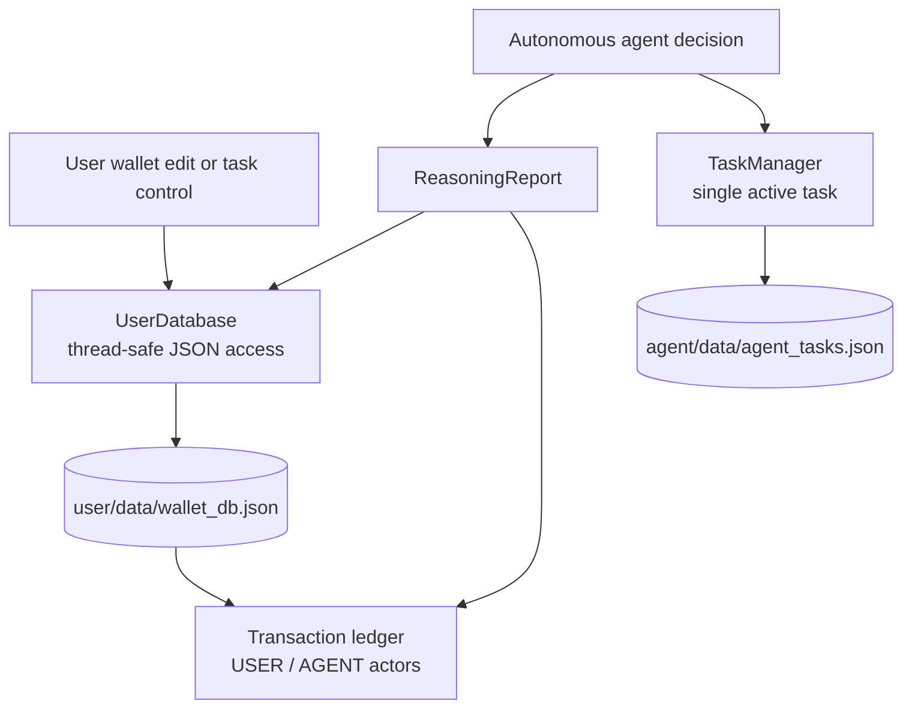
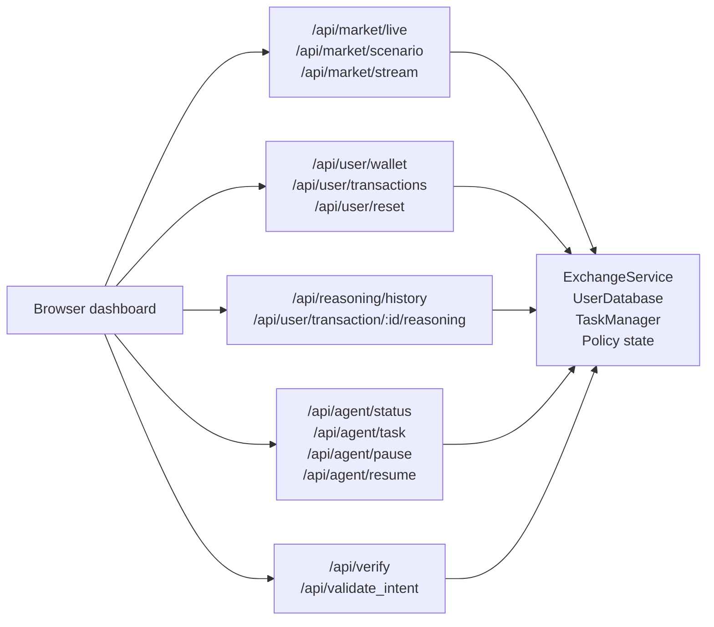

# WalletAgent

> **Autonomous Web3 Wallet Agent with Z3 Formal Policy Verification & RAG Cognitive Reasoning**

WalletAgent is a mathematically verified autonomous trading agent and wallet policy engine designed for EVM networks (Base Sepolia / Ethereum). It bridges the gap between natural language user intent and provably secure on-chain execution by pairing LLM semantic synthesis with deterministic Z3 SMT solver verification, historical market RAG retrieval, and strict invariant policy guards.

---

## 🌟 Key Features

### 1. Dual-Channel Natural Language Policy Compilation
- **Channel A (Deterministic Parser):** Rule-based semantic dependency parser powered by spaCy and custom grammar rules.
- **Channel B (LLM Synthesizer):** Multi-provider LLM support (Groq, Gemini, OpenAI, Anthropic, or local Ollama) for flexible natural language interpretation.
- **Ambiguity Detection & Resolution:** Proactively detects dimensional and semantic ambiguities (such as ambiguous percentages for gas thresholds) and presents structured mathematical interpretations for user selection.

### 2. Formal Verification & Z3 Equivalence Checking
- **Z3 SMT Solver:** Proves mathematical equivalence between the independent parser and the LLM's synthesis.
- **Safety Invariant Enforcing:** Invariants such as balance floors (`balance_after >= floor`), single transaction caps (`trade <= max_trade`), and cumulative daily spend caps (`spent_today + trade <= daily_limit`) are proved formally using first-order logic.
- **Sort & Type Safety:** Enforces strict dimensional types (`USD`, `GWEI`, `TOKEN`, `PERCENT`) to prevent unit confusion bugs.

### 3. Cognitive Agent Reasoning Engine (Fragmented Cognition)
- **Market History RAG:** Retrieves matching historical market regimes (e.g., *Post-Dip Mean Reversion*, *Gas Spike Congestion Panic*, *Overextended Bull Run*) based on real-time gas prices, volatility, and trend conditions.
- **Autonomous Intent Formulation:** Constructs clear trade theses with risk scoring and profitability outlooks.
- **Dry-Run Simulation:** Estimates slippage, calculates post-swap balances, and projects 24-hour value deltas and drawdown risk prior to execution.
- **Dual Gate Precedence:** Even if market conditions appear favorable, trades cannot execute unless Z3 formal invariant gates return `SAT`.

### 4. Autonomous Agent Daemon Runtime
- **Tick-by-Tick Evaluation:** Background monitoring daemon continuously assesses live market conditions against active task triggers.
- **Single-Task Lifecycle:** Enforces a clean single-active-task lifecycle (`RUNNING`, `FINISHED`, `STOPPED`) with human-in-the-loop control (Pause, Dismiss, Manual Override).
- **Audit Ledger:** Every transaction and dry-run decision records an immutable reasoning audit trail with solver status, RAG metrics, and execution hashes.

### 5. Live Market Feeds & Web3 Simulation
- **Coinbase WebSocket:** Real-time tick-by-tick ETH/USD pricing feed.
- **Ethereum / Base Sepolia RPC:** Live gas tracking (Base fee + Priority fee) and network state inspection (Base Sepolia Chain ID: `84532`).
- **Interactive Web Dashboard:** Lightweight, responsive dashboard built with Flask and Vanilla CSS/JS featuring live charts, interactive guard gate testing, and policy discovery.

---

## 🏗️ Architecture

WalletAgent is a single Python process with a Flask dashboard, background market-feed
workers, and one autonomous agent worker. The dashboard and agent share singleton
services for the exchange, policy state, task registry, reasoning engine, and wallet
database.

### System context



### Application components



---

## 🚀 Quickstart

### Prerequisites
- Python 3.10+ (tested on Python 3.11 - 3.14)
- Git

### 1. Clone & Set Up Virtual Environment

```bash
git clone https://github.com/immo2n/WalletAgent.git
cd WalletAgent

python3 -m venv .venv
source .venv/bin/activate
pip install -r requirements.txt
```

### 2. Configure Environment Variables

Copy the example environment configuration:

```bash
cp .env.example .env
```

Edit `.env` to configure your preferred LLM provider and network settings:

```dotenv
LLM_PROVIDER=groq
GROQ_API_KEY=your_groq_api_key_here
LLM_MODEL=openai/gpt-oss-20b

CHAIN_ID=84532
RPC_URL=https://sepolia.base.org
PORT=5000
```

*(Note: If no API key is provided, the engine automatically falls back to deterministic rule-based evaluation and mock LLM synthesis for testing).*

### 3. Run the Application

```bash
python main.py
```

Open your browser and navigate to:
```
http://127.0.0.1:5000
```

---

## 🔄 Runtime Flows

### Application startup



### Natural-language policy verification



### Continuous autonomous decision loop



### Trigger-to-execution reasoning pipeline



### Market perception and scenario overrides



### Persistence and audit trail



### Dashboard API surface



## 🧪 Running Tests

The test suite covers formal AST verification, dual-reader equivalence, parser mutations, RAG regime matching, and autonomous runtime loops:

```bash
PYTHONPATH=. pytest tests/
```

All 79 unit and integration tests should pass:
```text
============================== 79 passed in 6.12s ==============================
```

---

## 📖 Example Policies & Prompts

| User Prompt | Action Type | Verified Behavior |
|:---|:---|:---|
| `Buy ETH when gas is under 20 gwei, and never let my balance drop below 500 dollars.` | Compound (Trigger + Guard) | Executes swap when gas `<= 20 gwei` while formally proving balance floor `>= $500`. |
| `Never let balance go under 10000.` | Safety Guard Invariant | Pure invariant monitoring; blocks any trade that reduces USDC balance under $10,000. |
| `Don't spend more than 300 dollars in one transaction.` | Transaction Cap | Invariant guard ensuring `trade <= 300` for all autonomous actions. |
| `Buy if gas price is under 5% and do not go under 500 dollars balance.` | Ambiguous Trigger | Prompts user with 4 mathematical reinterpretations (e.g. 5% below 24h moving average). |

---

## 📁 Repository Structure

```
WalletAgent/
├── agent/                  # Autonomous daemon runtime, task models, and single-task registry
├── exchange/               # Market feeds, WebSocket clients, and live price/gas polling
├── flask/                  # Web dashboard templates, static assets, and API routes
├── policy/                 # Z3 formal verification engine, AST definitions, and parsers
│   ├── ast.py              # First-order logic AST expressions
│   ├── typecheck.py        # Dimensional sort and type checking
│   ├── compare.py          # Z3 equivalence and counterexample checker
│   ├── loop.py             # Dual-reader verification orchestration
│   ├── z3_compile.py       # Named Z3 constraints and bounded domain
│   └── readers/            # RuleReader (spaCy) and LLMReader
├── reasoning/              # Fragmented cognitive reasoning pipeline
│   ├── data/               # Historical market regime database
│   ├── rag.py              # Thread-safe market regime RAG retriever
│   ├── dry_run.py          # Slippage, balance, and risk simulation
│   └── engine.py           # Intent, risk, gate, and audit orchestration
├── testing/                # Supported phrase catalog and reference prompts
├── tests/                  # Pytest unit and integration suite
├── user/                   # Persistent wallet database, balance tracking, and ledger
├── main.py                 # Application entrypoint
└── requirements.txt        # Project dependencies
```

---

## 📄 License

MIT License. See [LICENSE](LICENSE) for details.
