# Orvilo: User-Defined On-Chain Guardrails for Autonomous AI Wallets

> **Orvilo implementation repository — local verification, guardrail simulation, and autonomous wallet dashboard**

<p align="left">
  <a href="docs/technical-doc.md">
    
  </a>
  <a href="docs/technical-doc.md#fintechathon-2026-scorecard-feature-coverage-matrix">
    
  </a>
  <a href="docs/technical-doc.md#empirical-test-verification--test-execution">
    
  </a>

  <a href="docs/smart-contracts.md#7-base-sepolia-deployment-configuration">
    
  </a>
</p>

> 📚 **Documentation Hub**: [**Technical Architecture & Competition Specification**](docs/technical-doc.md) • [**Pitch Deck Blueprint**](docs/pitch-deck-info.md) • [**Policy Engine & Z3 SMT**](docs/policy-engine.md) • [**Agent Runtime & RAG**](docs/agent-runtime.md) • [**Smart Contracts & Security**](docs/smart-contracts.md) • [**User Approval & Audit**](docs/user-and-audit.md)

Orvilo is a mathematically verified autonomous trading agent and wallet policy engine designed for EVM networks (Base Sepolia / Ethereum). It bridges the gap between natural language user intent and provably secure on-chain execution by pairing LLM semantic synthesis with deterministic Z3 SMT solver verification, historical market RAG retrieval, and strict invariant policy guards.

> **Implementation status:** The repository is a local Flask simulation and verification environment. The policy compiler, Z3 gates, EVM simulator, wallet client, attack tester, dashboard, and audit ledger are implemented and tested. Local execution mutates JSON state and does not broadcast real transactions unless a separately configured production signing and deployment layer is added.

## 📚 Documentation map

| Document | Contents |
|:---|:---|
| [Technical documentation PDF](WalletAgent_Technical_Documentation.pdf) | A4-ready implementation report with verified architecture, workflows, testing evidence, and Mermaid figures |
| [Technical documentation source](docs/technical-report.html) | Reproducible HTML source used to generate the PDF |
| [Technical architecture](docs/technical-doc.md) | System overview, feature matrix, runtime flows, API surface, testing, and deployment notes |
| [Technical documentation Word document](docs/final/Orvilo_Technical_Documentation.docx) | Official editable technical documentation with embedded diagrams and REST API spec |
| [Security self-assessment](docs/security-self-assessment.md) | Evidence-based security report with permission-tier matrix, known-risk register, test evidence, and trust-boundary diagrams |
| [Security self-assessment Word document](docs/final/Orvilo_Security_Self_Assessment_Report.docx) | Editable report generated from the Markdown assessment with embedded diagrams |
| [Execution evidence report](docs/execution-evidence-report.md) | Empirical sandbox execution records, scenario register (EE-01 to EE-07), test verification, and disclosed gaps |
| [Execution evidence Word document](docs/final/Orvilo_Execution_Evidence_Report.docx) | Editable evidence report with embedded execution logs and checksums |
| [Policy engine](docs/policy-engine.md) | Natural-language parsing, typed ASTs, Z3 equivalence checking, and policy workflow |
| [Agent runtime](docs/agent-runtime.md) | Market feeds, autonomous loop, scheduling, RAG reasoning, dry-run checks, and task lifecycle |
| [Smart contracts and security](docs/smart-contracts.md) | Solidity guards, simulator behavior, emergency controls, and attack-test vectors |
| [User approval and audit](docs/user-and-audit.md) | Approval states, audit records, dashboard behavior, and operator controls |
| [Pitch deck reference](docs/pitch-deck-info.md) | Demonstration narrative and scorecard evidence |
| [Mermaid visual sources](visuals/) | A4-oriented Mermaid diagrams and rendered PNG figures |

---

## 🌟 Key Features

### 1. Dual-Channel Natural Language Policy Compilation
- **Channel A (Deterministic Parser):** Rule-based semantic dependency parser powered by spaCy and custom grammar rules.
- **Channel B (LLM Synthesizer):** Schema-constrained reader with the offline
  `mock` provider enabled by default. A Groq adapter exists as an optional
  integration, but the checked-in/local configuration does not use it.
- **Ambiguity Detection & Resolution:** Proactively detects dimensional and semantic ambiguities (such as ambiguous percentages for gas thresholds) and presents structured mathematical interpretations for user selection.

### 2. Formal Verification & Z3 Equivalence Checking
- **Z3 SMT Solver:** Proves mathematical equivalence between the independent parser and the LLM's synthesis.
- **Safety Invariant Enforcing:** Invariants such as balance floors (`balance_after >= floor`), single transaction caps (`trade <= max_trade`), and cumulative daily spend caps (`spent_today + trade <= daily_limit`) are proved formally using first-order logic.
- **Sort & Type Safety:** Enforces strict dimensional types (`USD`, `GWEI`, `TOKEN`, `PERCENT`) to prevent unit confusion bugs.

### 3. Cognitive Agent Reasoning Engine (Fragmented Cognition)
- **Market History RAG:** Retrieves matching historical market regimes (e.g., *Post-Dip Mean Reversion*, *Gas Spike Congestion Panic*, *Overextended Bull Run*) based on real-time gas prices, volatility, and trend conditions.
- **Autonomous Intent Formulation:** Constructs clear trade theses with risk scoring and profitability outlooks.
- **Dry-Run Simulation:** Estimates slippage, calculates post-swap balances, and projects 24-hour value deltas and drawdown risk prior to execution.
- **Dual Gate Precedence:** Even if market conditions appear favorable, trades cannot execute unless Z3 formal invariant gates return `SAT`.

### 4. Autonomous Agent Daemon Runtime
- **Tick-by-Tick Evaluation:** Background monitoring daemon continuously assesses live market conditions against active task triggers.
- **Single-Task Lifecycle:** Enforces a clean single-active-task lifecycle (`RUNNING`, `FINISHED`, `STOPPED`) with human-in-the-loop control (Pause, Dismiss, Manual Override).
- **Audit Ledger:** Transaction and reasoning reports are persisted in a mutable local JSON file. Records include actor, status, guard reasons, RAG metrics, and generated identifiers; this is not an immutable production ledger.

### 5. Live Market Feeds & Web3 Simulation
- **Coinbase WebSocket:** Real-time tick-by-tick ETH/USD pricing feed.
- **Ethereum L1 gas oracle and Coinbase feed:** Background adapters attempt live observations, while deterministic scenario injection remains available for repeatable demos. Base Sepolia is the configured contract reference; the default wallet flows do not submit transactions.
- **Interactive Web Dashboard:** Lightweight, responsive dashboard built with Flask and Vanilla CSS/JS featuring live charts, interactive guard gate testing, and policy discovery.

### 6. Conversational LLM Assistant & Anomaly Auditor (LangChain Powered)
- **Deep System Connection:** Floating conversational bubble connected directly to the live wallet database, task registry, autonomous agent loop, on-chain policy client, market feeds, and attack testing suite.
- **Transaction Anomaly Detection:** Cognitively audits transaction ledgers to flag unapproved recipients, drain attempts threatening the $500 balance floor, over-cap transactions, and gas surge executions with categorized risk severity (`CRITICAL`, `ELEVATED`, `SECURE`, `CLEAN`).
- **Autonomous Task Explanations:** Explains the agent's current mission, breaks down formal Z3 readbacks, compares live gas perceptions against thresholds, and tracks recurring DCA cadence.
- **LangChain & Hybrid Synthesis:** Leverages `langchain_core` message abstractions with optional live LLM inference and deterministic cognitive fallbacks for offline reliability.


---

## 🏗️ Architecture

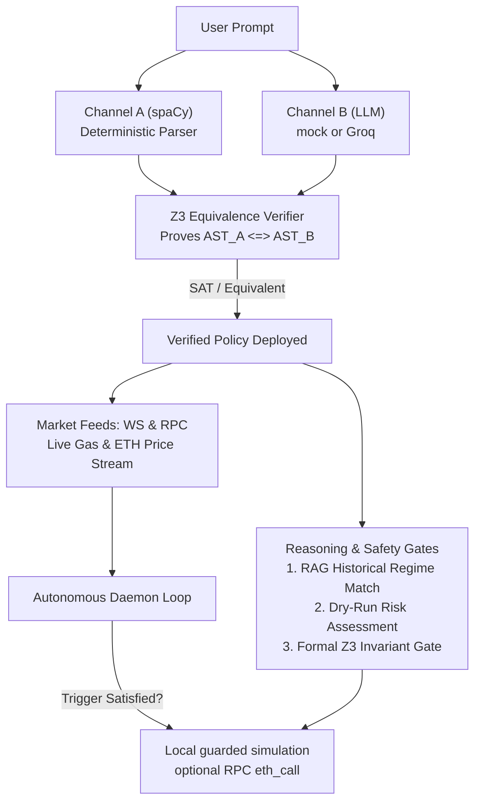

Orvilo is a single Python process with a Flask dashboard, background market-feed
workers, and one autonomous agent worker. The dashboard and agent share singleton
services for the exchange, policy state, task registry, reasoning engine, and wallet
database.

### System context

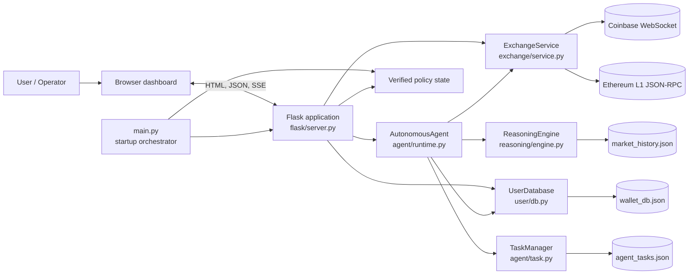

### Application components

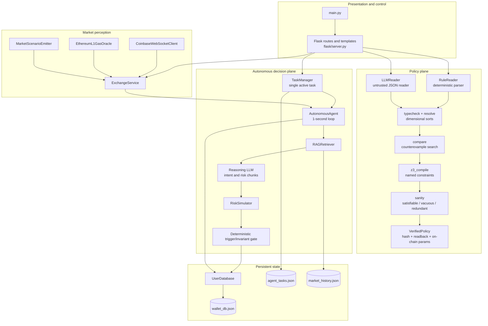

---

## 🚀 Setup and Quickstart

### Prerequisites
- Python 3.10+ (tested on Python 3.11 - 3.14)
- Git
- A supported OS with a working C/C++ build toolchain for Python packages when binary wheels are unavailable
- Optional: an API key for a supported LLM provider

The default configuration is safe for local development: the implemented
offline provider is `mock`, which uses the deterministic rule reader and mock
LLM reader. Wallet balances, transactions, and task state are stored in local
JSON files for the simulation.

### 1. Clone & Set Up Virtual Environment

```bash
git clone https://github.com/immo2n/WalletAgent.git
cd Orvilo

python3 -m venv .venv
source .venv/bin/activate
pip install -r requirements.txt
```

On Windows PowerShell, activate the environment with:

```powershell
.venv\Scripts\Activate.ps1
```

If the shell does not activate virtual environments, run the project commands
through the interpreter directly:

```bash
.venv/bin/python --version
```

### 2. Configure Environment Variables

Copy the example environment configuration:

```bash
cp .env.example .env
```

Edit `.env` to configure the implemented LLM provider:

```dotenv
# Offline development:
LLM_PROVIDER=mock

# Optional Groq-compatible policy reader (not required for local operation):
# LLM_PROVIDER=groq
# GROQ_API_KEY=replace_with_a_rotated_key
# LLM_MODEL=llama-3.3-70b-versatile

LLM_MODEL=mock
# LLM_BASE_URL=https://api.groq.com/openai/v1/chat/completions
```

The application currently implements `mock` and `groq` adapters. The local
configuration uses `mock`. The
`gemini`, `openai`, `anthropic`, and `ollama` names are not implemented by the
current adapters. The `CHAIN_ID`, `RPC_URL`, `EXPLORER_URL`, contract/key,
market API key, and timeout values in `.env.example` are reference settings
for future integrations; the local simulation does not read them. The CLI
uses `--host` and `--port` rather than a `PORT` environment variable.

If you use a live provider, never commit `.env` or API keys.

### 3. Verify the Policy Engine

Run the formal policy discovery without starting the web server:

```bash
PYTHONPATH=. python main.py --cli-only
```

The command should finish with a successful verified policy and exit without
binding a network port.

### 4. Run the Application

```bash
PYTHONPATH=. python main.py
```

Open your browser and navigate to:
```
http://127.0.0.1:5000
```

Useful runtime options:

```bash
PYTHONPATH=. python main.py --host 127.0.0.1 --port 5000
PYTHONPATH=. python main.py --prompt "Buy ETH when gas is under 20 gwei and keep at least 500 dollars."
```

Stop the local server with `Ctrl+C`.

### 5. Run with Docker

Build and start the complete local simulation in a container. The image runs
as the non-root `orvilo` user and uses the offline mock LLM by default, so no
API key is required:

```bash
docker build --tag orvilo:latest .
docker run --detach \
  --name orvilo \
  --publish 5000:5000 \
  orvilo:latest
```

Open [http://127.0.0.1:5000](http://127.0.0.1:5000). The image binds Flask to
`0.0.0.0` and includes a Docker health check backed by
`/api/market/live`. Verify the container and health state with:

```bash
docker ps
docker inspect --format '{{.State.Health.Status}}' orvilo
curl http://127.0.0.1:5000/api/market/live
```

The expected Docker health status is `healthy`. Container JSON state is
ephemeral by default; stopping and recreating the container starts from the
repository seed state. Stop and remove the container with:

```bash
docker stop orvilo
docker rm orvilo
```

Docker Compose is also supported:

```bash
docker compose up --build
docker compose down
```

#### Docker configuration

The default container configuration is:

```env
LLM_PROVIDER=mock
LLM_MODEL=mock
CHAIN_ID=84532
RPC_URL=https://sepolia.base.org
PORT=5000
```

To provide optional runtime configuration, use a local, untracked environment
file. Never commit credentials or put API keys in the Dockerfile:

```bash
docker run --detach \
  --name orvilo \
  --publish 5000:5000 \
  --env-file .env \
  orvilo:latest
```

#### Validate all Docker functionality

The repository includes a bounded API smoke test at
[scripts/docker_smoke.py](scripts/docker_smoke.py). With the container
running, execute:

```bash
docker exec orvilo \
  python scripts/docker_smoke.py http://127.0.0.1:5000
```

It verifies the dashboard, market API and SSE stream, wallet, transactions,
reasoning, policy verification and deployment, agent controls and scheduling,
intent validation, simulation, contract security, all six attack vectors,
assistant chat, and reset flows. A successful run prints:

```text
Docker smoke test passed: dashboard, market, wallet, policy, agent, simulation, contract, attacks, assistant.
```

#### Export and share the Docker image

Export the image as a compressed archive:

```bash
docker save orvilo:latest | gzip > orvilo-latest.tar.gz
```

On another machine, import and run it:

```bash
docker load < orvilo-latest.tar.gz
docker run --detach \
  --name orvilo \
  --publish 5000:5000 \
  orvilo:latest
```

The CI workflow runs the Python suite, builds the image, starts a temporary
container, waits for its Docker health check, and exercises the complete API
smoke test in [scripts/docker_smoke.py](scripts/docker_smoke.py), including
market, wallet, policy, agent, simulation, contract, attack-test, reasoning,
and assistant functionality.

## 🔌 Dashboard API Reference

The Flask dashboard exposes the following local simulation endpoints. All mutating
routes operate on the local application state unless explicitly described
otherwise.

| Area | Methods and routes |
|:---|:---|
| Dashboard | `GET /` |
| Market | `GET /api/market/live`, `POST /api/market/scenario`, `GET /api/market/stream` |
| Wallet | `GET,POST /api/user/wallet`, `GET /api/wallet/balances` |
| Transactions | `GET,POST /api/user/transactions`, `GET,POST /api/wallet/transactions` |
| Reset | `POST /api/user/reset`, `POST /api/simulation/reset` |
| Reasoning | `GET /api/user/transaction/<tx_id>/reasoning`, `GET,POST /api/reasoning/history` |
| Agent | `GET /api/agent/status`, `GET,POST,DELETE /api/agent/task` |
| Agent control | `POST,DELETE /api/agent/task/delete`, `POST /api/agent/task/stop`, `POST /api/agent/task/rerun`, `POST /api/agent/pause`, `POST /api/agent/resume` |
| Scheduling | `POST /api/agent/schedule` |
| Policy | `POST /api/verify`, `POST /api/validate_intent`, `GET /api/policy/workflow`, `POST /api/policy/review`, `POST /api/policy/approve`, `POST /api/policy/deploy` |
| Contract security | `GET /api/contract/security-status`, `POST /api/contract/pause`, `POST /api/contract/unpause`, `POST /api/contract/revoke-operator`, `POST /api/contract/revoke-allowance`, `POST /api/contract/invalidate-policy` |
| Simulation and attacks | `POST /api/simulation/simulate`, `GET /api/contract/attack-test/vectors`, `POST /api/contract/attack-test/run` |
| Conversational assistant | `POST /api/assistant/chat` |

Example requests:

```bash
curl -fsS http://127.0.0.1:5000/api/market/live
curl -fsS -X POST http://127.0.0.1:5000/api/market/scenario \
  -H 'Content-Type: application/json' \
  -d '{"scenario":"REAL_MARKET"}'
curl -fsS -X POST http://127.0.0.1:5000/api/verify \
  -H 'Content-Type: application/json' \
  -d '{"prompt":"Buy ETH when gas is under 20 gwei and keep at least 500 dollars."}'
curl -fsS -X POST http://127.0.0.1:5000/api/validate_intent \
  -H 'Content-Type: application/json' \
  -d '{"trade_usd":200,"gas_gwei":10,"execute":false}'
```

`/api/market/stream` is an open Server-Sent Events stream and is intended for
browser clients; do not use it as a terminating smoke-test command. Setting
`execute` to `true` on `/api/validate_intent` mutates the local JSON wallet
ledger and does not submit an on-chain transaction.

---

## 💬 Conversational LLM Assistant & Anomaly Auditor

The dashboard features a floating conversational assistant (`agent/assistant.py`) integrated on both desktop and mobile layouts. Powered by LangChain and structured cognitive reasoning, it serves as an intelligent co-pilot directly wired into the runtime engine, on-chain policy client, and ledger database.

### 🧩 Subsystem Connection

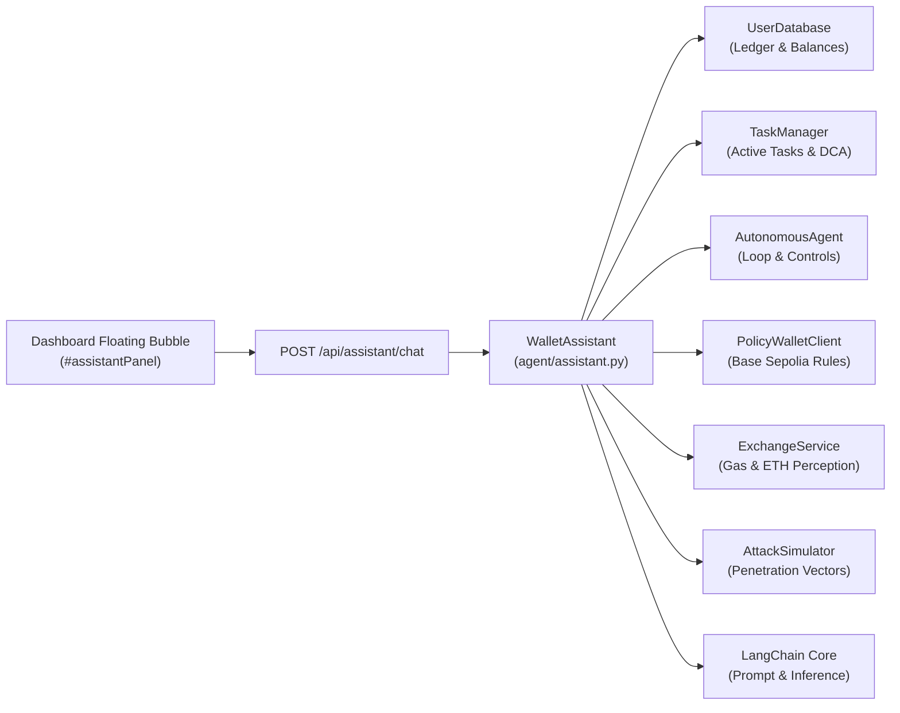

### 🛡️ Core Capabilities

1. **Transaction Security & Anomaly Auditing (`/api/assistant/audit`)**:
   - **Unapproved Recipient Inspection:** Cross-checks transfers and withdrawals against verified contract allowlists (`allowed_recipients`) to detect unauthorized recipient addresses.
   - **Solvency Drain Prevention:** Inspects attempts threatening the `$500.00` USDC reserve floor, highlighting transactions intercepted by formal Z3 invariant guards.
   - **Transaction Cap Violation Checks:** Scans for transactions exceeding the configured per-transaction cap ($300–$1,000) or cumulative daily limits.
   - **Gas Surge Profiling:** Identifies trades executed during adverse gas conditions (>25 gwei).
   - **Risk Scoring:** Assigns categorized risk verdicts: `✅ CLEAN & VERIFIED`, `🛡️ SECURE (Guards Active)`, `⚠️ ELEVATED`, or `🚨 CRITICAL`.

2. **Autonomous Task Explanations (`/api/assistant/tasks`)**:
   - **Goal & AST Breakdown:** Explains user prompts, formal dual-reader readbacks, and policy hashes in plain English.
   - **Dynamic Trigger Evaluation:** Evaluates live market conditions against active task triggers in real time (e.g. *Gas Threshold: <= 20.0 gwei | Current Live Gas: 0.5 gwei -> SATISFIED*).
   - **Active Safety Invariants:** Details enforced balance floors ($500), single trade limits ($300), and asset allowlists.
   - **Cadence & Execution History:** Summarizes completed cycle counts, Base Sepolia transaction hashes, and recurring DCA intervals.

3. **Interactive Actions & Safe Dashboard Controls**:
   - **Dry-Run Invariant Simulations:** Formally evaluates prospective trade amounts (e.g. *"Simulate a $200 swap"*) against balance floors and single-transaction caps.
   - **Simulation Scenario Toggles:** Switches the simulator to `HIGH_GAS` (35 gwei) or `GAS_DIP` (0.5 gwei) directly from chat.
   - **Penetration Testing:** Triggers the 6-vector adversarial attack suite and redirects to the rejection view.
   - **Runtime Gating:** Pauses or resumes autonomous agent monitoring loops with safety confirmation dialogs.

4. **LangChain & Hybrid Cognitive Synthesis**:
   - Utilizes `langchain_core` message schema (`HumanMessage`, `AIMessage`, `ChatPromptTemplate`).
   - Supports multi-provider live LLM synthesis (Groq, Gemini, OpenAI) when API keys are configured.
   - Includes a deterministic, offline-safe cognitive synthesis fallback ensuring 100% availability with 0ms latency during local demonstrations.

### 💡 Example Prompts & Use Cases

| Category | Example User Query | Assistant Response & Action |
|:---|:---|:---|
| **Security Audit** | `"Are there any suspicious transactions?"` | Audits ledger, scores anomalies, navigates to Ledger tab |
| **Task Explanation** | `"What is the agent currently doing?"` | Explains active goals, triggers, and Z3 invariants |
| **Solvency Simulation** | `"Simulate a $200 swap"` | Formally checks balance after trade vs $500 floor |
| **Balance & Holdings** | `"What is my wallet balance?"` | Reports ETH, USDC, reserve floor, and available spending liquidity |
| **Penetration Testing** | `"Run all attack tests"` | Executes 6 attack vectors and validates typed Solidity reverts |
| **Market Perception** | `"What is the current market?"` | Reports real-time ETH price and Base Sepolia gas in gwei |
| **Scenario Control** | `"Switch to high gas scenario"` | Sets gas to 35 gwei to demonstrate invariant holding behavior |
| **Runtime Control** | `"Pause the agent"` | Prompts confirmation and halts background monitoring daemon |

### 🔌 Assistant API Reference

```bash
# Natural language chat & action routing
curl -fsS -X POST http://127.0.0.1:5000/api/assistant/chat \
  -H 'Content-Type: application/json' \
  -d '{"message":"Audit transactions for suspicious activity"}'

# Direct JSON security audit
curl -fsS http://127.0.0.1:5000/api/assistant/audit

# Direct JSON active task explanation
curl -fsS http://127.0.0.1:5000/api/assistant/tasks
```


### Dashboard behavior

- **Dark mode:** enabled by default; the header toggle switches to light mode.
- **Timezone:** Beijing (`Asia/Shanghai`) is the default. The selector also
  supports UTC, local time, US Eastern/Pacific, London, Berlin, Dhaka, Tokyo,
  Singapore, and Sydney. The choice is stored in browser `localStorage`.
- **Mobile navigation:** the seven primary sections remain visible in the
  fixed bottom navigation on standard phone widths, with safe-area spacing for
  modern iOS and Android devices.
- **Floating assistant:** the launcher is positioned above the mobile
  navigation and the open panel uses the same safe-area clearance.

---

## 🚢 Deployment

Orvilo is a simulation and verification dashboard, not a production
custody service. Deploy it only in a trusted environment, do not commit
`.env` files or API keys, and do not connect it to real funds without adding
production-grade authentication, secret management, persistence, monitoring,
and transaction signing controls.

### Single-host deployment

1. Provision Python 3.10 or newer and Git on the host.
2. Clone the repository and create the virtual environment:

   ```bash
   git clone https://github.com/immo2n/WalletAgent.git
   cd Orvilo
   python3 -m venv .venv
   .venv/bin/python -m pip install -r requirements.txt
   ```

3. Create `.env` from `.env.example` and configure only the required provider
   values.
4. Run the dashboard on the host interface:

   ```bash
   .venv/bin/python main.py --host 0.0.0.0 --port 5000
   ```

5. Restrict port `5000` with the host firewall or place the service behind a
   TLS-terminating reverse proxy. The application currently exposes a
   development Flask server and should not be exposed directly to the public
   internet.
6. Keep `user/data/wallet_db.json`, `agent/data/agent_tasks.json`, and other
   local state files on persistent storage. Back them up before upgrades.

For a production deployment, run the Flask application behind a production
WSGI server and reverse proxy. The repository does not include a WSGI server
dependency or a deployment manifest; add and pin those deployment dependencies
according to the target platform rather than installing them implicitly.

### Deployment checklist

- [ ] Use a dedicated virtual environment.
- [ ] Configure secrets through the platform secret store or protected
  environment variables.
- [ ] Keep `.env` out of version control.
- [ ] Run `PYTHONPATH=. python main.py --cli-only` during release verification.
- [ ] Run the full test suite before starting the service.
- [ ] Restrict network access and terminate HTTPS at a trusted proxy.
- [ ] Persist and back up JSON state files.
- [ ] Monitor application logs and restart the service on failure.

### Local port note

Port `5000` can already be occupied by macOS Control Center/AirPlay Receiver.
Use another port when necessary:

```bash
PYTHONPATH=. .venv/bin/python main.py --host 127.0.0.1 --port 5001
```

The dashboard is then available at `http://127.0.0.1:5001`.

## 🧪 Testing

Run the complete test suite from the repository root:

```bash
.venv/bin/python -m pytest -q
```

The current suite contains 94 collected tests covering policy parsing and
verification, task scheduling, agent behavior, conversational assistant, Flask routes,
wallet state, contract simulation, attack vectors, and scorecard features. A focused run is
useful when changing the dashboard backend:

```bash
.venv/bin/python -m pytest -q tests/test_agent.py tests/test_assistant.py tests/test_scorecard_features.py
```

Do not commit generated runtime state from `agent/data/agent_tasks.json` or
`user/data/wallet_db.json` unless a fixture or migration explicitly requires
it. Reset local state through the dashboard reset controls or the documented
reset endpoints.

---

## 🔄 Runtime Flows

### Application startup

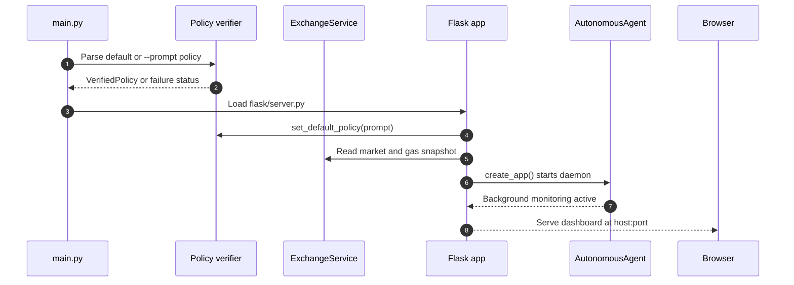

### Natural-language policy verification

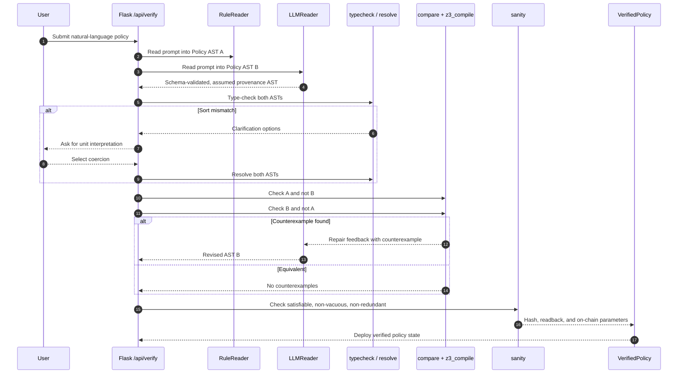

### Continuous autonomous decision loop

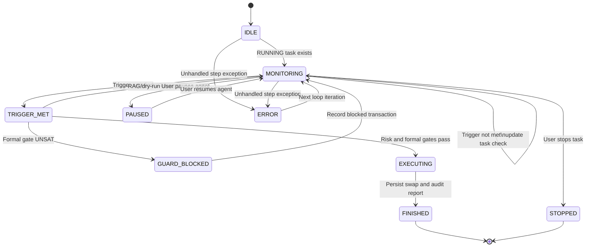

### Trigger-to-execution reasoning pipeline

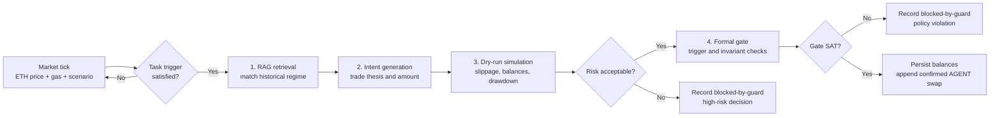

### Market perception and scenario overrides

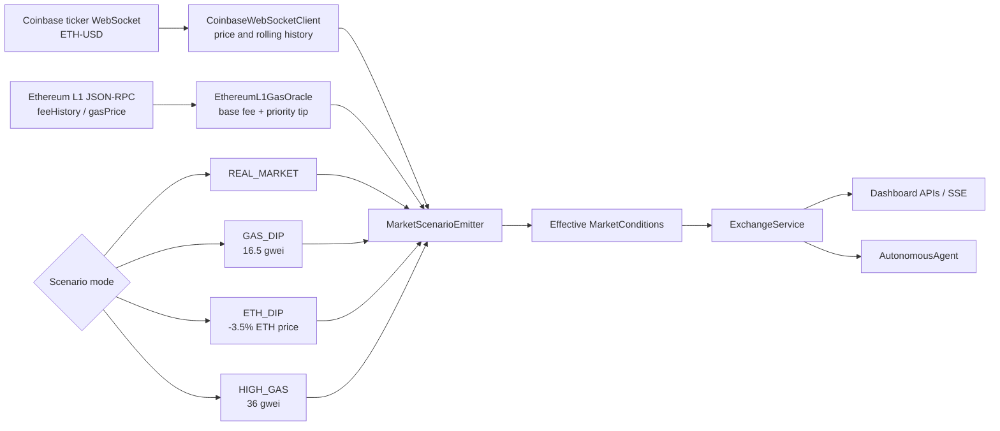

### Persistence and audit trail

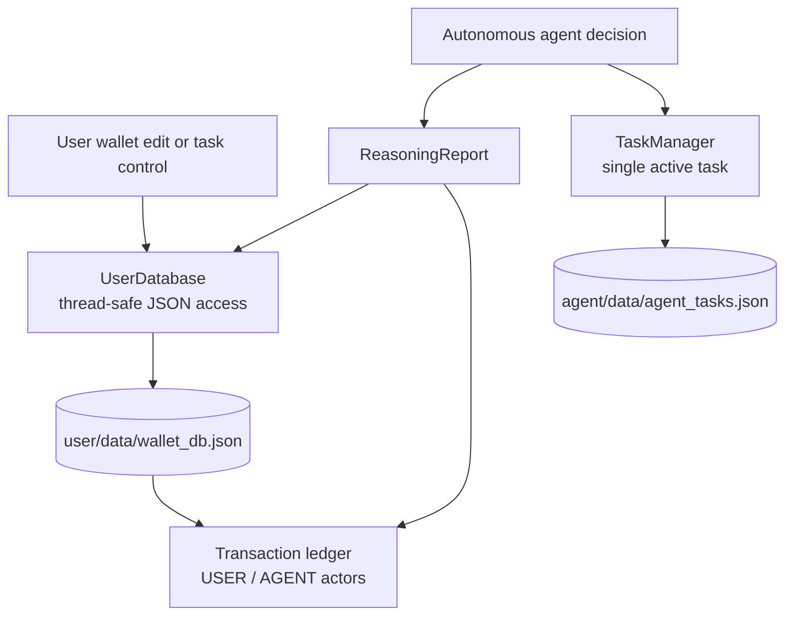

### Dashboard API surface

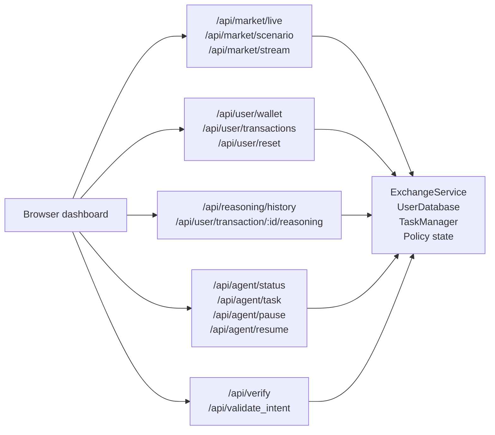

## 🧪 Tests and Test Cases

The test suite covers formal AST verification, dual-reader equivalence, parser mutations, RAG regime matching, and autonomous runtime loops:

```bash
PYTHONPATH=. pytest tests/
```

Run focused groups while developing:

```bash
PYTHONPATH=. pytest tests/policy
PYTHONPATH=. pytest tests/test_agent.py tests/test_reasoning.py
PYTHONPATH=. pytest tests/test_exchange.py tests/test_user_db.py
```

The expected test count can change as the suite evolves. A successful run
should report zero failures and zero errors:

```text
============================== N passed in ...s ===============================
```

### Test-case matrix

| ID | Area | Test case | Expected result |
|:---|:---|:---|:---|
| TC-01 | Setup | Create `.venv` and install `requirements.txt` | Dependencies install successfully |
| TC-02 | Policy verification | Run `python main.py --cli-only` | Policy is parsed, type-checked, verified by Z3, and the process exits successfully |
| TC-03 | Policy equivalence | Submit a supported natural-language policy | Deterministic and LLM/mock interpretations match or request clarification |
| TC-04 | Safety invariants | Verify a balance-floor or transaction-cap policy | Unsafe trades are rejected by the formal guard |
| TC-05 | RAG reasoning | Evaluate a market condition with a matching historical regime | RAG context, risk score, and recommendation are included in the reasoning report |
| TC-06 | Dry run | Test a proposed swap before execution | Slippage, received amount, post-trade balance, and risk are calculated without changing balances |
| TC-07 | Wallet ledger | Edit balances or run a simulated swap | Balances and the USER/AGENT transaction ledger persist to JSON |
| TC-08 | Agent lifecycle | Start, pause, resume, stop, dismiss, and re-run a task | Task state transitions remain within the supported lifecycle |
| TC-09 | Dashboard API | Start the server and request `/` | HTTP 200 response and dashboard HTML are returned |
| TC-10 | Responsive UI | Open the dashboard at desktop and mobile widths | Tabs, forms, activity cards, and navigation remain usable without horizontal overflow |
| TC-11 | Theme UI | Toggle dark/light mode and reload | Theme changes immediately and the explicit user preference persists |
| TC-12 | Activity audit | Open Activity and inspect a transaction’s reasoning report | Actor, amount, status, transaction hash, and reasoning details remain readable |

### Dashboard smoke test

With the server running, verify the primary route and a live API endpoint:

```bash
curl -fsS -o /dev/null -w "Dashboard: HTTP %{http_code}\n" http://127.0.0.1:5000/
curl -fsS http://127.0.0.1:5000/api/market/live
```

The first command should report `Dashboard: HTTP 200`. The second should
return JSON containing the current market state.

---

## 📖 Example Policies & Prompts

| User Prompt | Action Type | Verified Behavior |
|:---|:---|:---|
| `Buy ETH when gas is under 20 gwei, and never let my balance drop below 500 dollars.` | Compound (Trigger + Guard) | Executes swap when gas `<= 20 gwei` while formally proving balance floor `>= $500`. |
| `Never let balance go under 10000.` | Safety Guard Invariant | Pure invariant monitoring; blocks any trade that reduces USDC balance under $10,000. |
| `Don't spend more than 300 dollars in one transaction.` | Transaction Cap | Invariant guard ensuring `trade <= 300` for all autonomous actions. |
| `Buy if gas price is under 5% and do not go under 500 dollars balance.` | Ambiguous Trigger | Prompts user with 4 mathematical reinterpretations (e.g. 5% below 24h moving average). |

---

## 📁 Repository Structure

```
WalletAgent/
├── agent/                  # Autonomous runtime, tasks, assistant & anomaly auditor
│   ├── assistant.py        # Conversational system assistant & anomaly auditor
│   ├── runtime.py          # Continuous agent decision loop and thread daemon
│   └── task.py             # AgentTask dataclass and TaskManager registry
├── exchange/               # Market feeds, WebSocket clients, and live price/gas polling
├── flask/                  # Web dashboard templates, static assets, and API routes
├── policy/                 # Z3 formal verification engine, AST definitions, and parsers
│   ├── ast.py              # First-order logic AST expressions
│   ├── typecheck.py        # Dimensional sort and type checking
│   ├── compare.py          # Z3 equivalence and counterexample checker
│   ├── loop.py             # Dual-reader verification orchestration
│   ├── z3_compile.py       # Named Z3 constraints and bounded domain
│   └── readers/            # RuleReader (spaCy) and LLMReader
├── reasoning/              # Fragmented cognitive reasoning pipeline
│   ├── data/               # Historical market regime database
│   ├── rag.py              # Thread-safe market regime RAG retriever
│   ├── dry_run.py          # Slippage, balance, and risk simulation
│   └── engine.py           # Intent, risk, gate, and audit orchestration
├── testing/                # Supported phrase catalog and reference prompts
├── tests/                  # Pytest unit and integration suite
├── user/                   # Persistent wallet database, balance tracking, and ledger
├── main.py                 # Application entrypoint
└── requirements.txt        # Project dependencies
```

---

## 📄 License

MIT License. See [LICENSE](LICENSE) for details.
