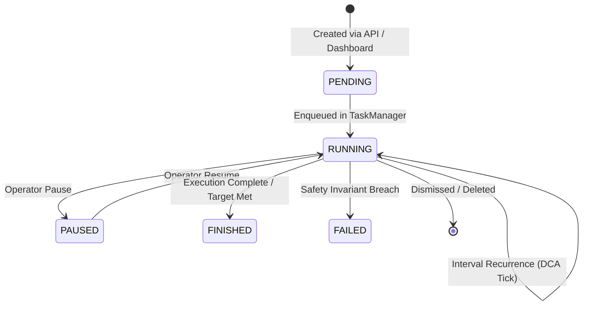

# Orvilo Autonomous Agent Runtime & Reasoning Engine Specification

> **Subsystem Specification**: Autonomous Daemon Runtime, Fragmented Cognitive Reasoning, Market Perception, and DCA Task Scheduler
> **Repository Modules**: [`agent/`](../agent/), [`reasoning/`](../reasoning/), [`exchange/`](../exchange/)
> **Key Architectural Principle**: *Perception feeds are deterministic; reasoning proposes trades; deterministic safety gates independently enforce all policy limits.*

---

## 1. Subsystem Architecture & Execution Topology

The Orvilo runtime coordinates market perception, intent formulation,
pre-execution risk modeling, deterministic gates, and local ledger updates
through isolated subsystems. The default runtime does not broadcast live
transactions.

```
┌────────────────────────────────────────────────────────────────────────┐
│                        MARKET PERCEPTION LAYER                         │
│  Coinbase WebSocket (ETH/USD)  │  L1 / Base Sepolia RPC (Gas Oracle)   │
└───────────────────────────────────┬────────────────────────────────────┘
                                    │ Live Market State (Gas, Price, Vol)
                                    ▼
┌────────────────────────────────────────────────────────────────────────┐
│                       AUTONOMOUS DAEMON RUNTIME                        │
│   TaskManager (Single Active Task / Recurring Scheduled DCA Queue)     │
│   AutonomousAgent (1 Hz Tick Evaluation Loop)                          │
└───────────────────────────────────┬────────────────────────────────────┘
                                    │ Trigger Condition Met
                                    ▼
┌────────────────────────────────────────────────────────────────────────┐
│                     FRAGMENTED COGNITIVE REASONING                     │
│  1. Market Regime RAG Retrieval (Cosine Similarity to Historical DB)   │
│  2. LLM Intent & Thesis Formulation (Trade Size, Direction, Min-Out)   │
│  3. Dry-Run Risk Simulation (Slippage, Drawdown, 24h Delta)            │
└───────────────────────────────────┬────────────────────────────────────┘
                                    │ Proposed Transaction + Expected State
                                    ▼
┌────────────────────────────────────────────────────────────────────────┐
│                   DETERMINISTIC INVARIANT SAFETY GATE                  │
│  Formal Z3 Balance Floor Check  │  Allowlist & Daily Expenditure Cap   │
└───────────────────────────────────┬────────────────────────────────────┘
                                    │ Clearance Confirmed (SAT)
                                    ▼
┌────────────────────────────────────────────────────────────────────────┐
│                 EVM PREFLIGHT & LOCAL LEDGER UPDATE                   │
│  optional eth_call  │  PolicyWallet model  │  JSON audit ledger        │
└────────────────────────────────────────────────────────────────────────┘
```

### Visual Subsystem Flowcharts
Below are the architectural diagrams rendered from the project visuals:

#### Agent Runtime Flow


#### Cognitive Reasoning & Safety Pipeline


#### Market Perception & Feed Ingestion


---

## 2. Autonomous Daemon Runtime Loop

- **Module**: [`agent/runtime.py`](../agent/runtime.py)
- **Class**: [`AutonomousAgent`](../agent/runtime.py#L25-L250)

The runtime daemon executes on a background thread with nominal one-second
ticks. `create_app()` starts the singleton daemon. At each tick, it executes
the following deterministic sequence:

1. **Active Task Inspection**: Queries [`TaskManager`](../agent/task.py#L50-L160) for currently registered tasks.
2. **Scheduled DCA Evaluation**: Checks the recurring scheduled queue to see if any cron-like interval or scheduled execution timestamp has matured.
3. **Market Perception Ingestion**: Fetches effective ETH price and gas state
   from [`ExchangeService`](../exchange/service.py#L25-L150), which combines
   the Coinbase snapshot, scenario offsets, and the L1 gas oracle.
4. **Trigger Evaluation**: Tests the active task's trigger conditions (e.g., $G_{\text{current}} \le G_{\text{threshold}}$). If unsatisfied, the daemon sleeps until the next tick without consuming LLM inference.
5. **Reasoning Pipeline Invocation**: Once triggers match, the daemon invokes the cognitive reasoning engine.
6. **Execution & State Update**: If all safety gates pass, records an AGENT
   transaction and updates the local JSON wallet ledger. Blocked and
   risk-aborted attempts are also recorded.

```python
# Simplified excerpt from agent/runtime.py
def _tick(self) -> None:
    task = self.task_manager.get_active_task()
    if not task or task.status != "RUNNING":
        return

    # Check recurring scheduled queue
    if task.schedule_type == "RECURRING_INTERVAL":
        if time.time() < task.next_run_at:
            return

    market = self.exchange_service.get_state()
    if not self._check_trigger(task, market):
        return  # Trigger not met; wait for favorable gas / price conditions

    # Trigger satisfied: proceed to fragmented reasoning
    intent = self.reasoning_engine.evaluate(task, market, self.wallet_db)
    if intent.decision == "EXECUTE":
        self._dispatch_transaction(intent)
```

---

## 3. Scheduled Transfers & Recurring DCA Task Queue

- **Module**: [`agent/task.py`](../agent/task.py)
- **Classes**: [`AgentTask`](../agent/task.py#L18-L48), [`TaskManager`](../agent/task.py#L50-L160)

FinTechathon 2026 Feature 4 mandates robust support for scheduled asset transfers and recurring dollar-cost averaging (DCA).

### 3.1 Task Lifecycle State Machine
Each task is governed by a strict lifecycle:
- `PENDING`: Task registered, awaiting trigger conditions or scheduled timestamp.
- `RUNNING`: Actively monitored on each tick by the background daemon.
- `PAUSED`: Temporarily suspended by operator manual override.
- `FINISHED`: Terminal state reached (one-shot trade completed or scheduled recurrence limit satisfied).
- `FAILED`: Execution aborted due to invariant breach or simulation error.



### 3.2 Recurring Interval & DCA Mechanics
The [`AgentTask`](../agent/task.py#L18-L48) schema supports granular scheduling parameters:
- `schedule_type`: `"IMMEDIATE"`, `"CONDITIONAL_TRIGGER"`, or `"RECURRING_INTERVAL"`.
- `interval_seconds`: Period between recurring executions (e.g., 60 seconds for demo DCA, 86,400 seconds for daily DCA).
- `max_executions`: Maximum number of recurring swaps before automatic task completion.
- `recipient`: Target address for automated transfers or DEX router address for swaps.
- `token`: Asset denomination (`USDC`, `WETH`, `ETH`).

---

## 4. Market Perception Layer

- **Modules**: [`exchange/client.py`](../exchange/client.py), [`exchange/gas_oracle.py`](../exchange/gas_oracle.py), [`exchange/emitter.py`](../exchange/emitter.py)
- **Coordinator**: [`ExchangeService`](../exchange/service.py)

To prevent LLM hallucination of market variables, **all market data originates strictly from deterministic feeds**. The LLM never supplies prices, gas estimates, or account balances.

### 4.1 Coinbase WebSocket Feed
- Connects directly to `wss://ws-feed.exchange.coinbase.com`.
- Subscribes to the `ETH-USD` ticker channel.
- Maintains a thread-safe, rolling ring buffer of tick prices, calculating real-time 1-hour and 24-hour volatility metrics.

### 4.2 Base Sepolia / Ethereum L1 Gas Oracle
- Regularly polls JSON-RPC endpoints (`eth_gasPrice`, `eth_maxPriorityFeePerGas`, `eth_feeHistory`).
- Deconstructs gas into:
  $$\text{Total Gas} = \text{Base Fee} + \text{Priority Fee}$$
- Maintains a 24-hour rolling average ($\bar{G}_{24h}$) and percentile distribution ($P_{90}, P_{50}, P_{10}$) to evaluate relative percentage triggers like *"buy when gas is in the lowest 10th percentile"*.

### 4.3 Deterministic Scenario Emitter
- **Module**: [`exchange/emitter.py`](../exchange/emitter.py)
- Enables zero-latency local testing and reproducible stress scenarios:
  - *Gas Spike Congestion*: Gas surges to 120 Gwei.
  - *Flash Dip*: ETH drops 8% in 3 minutes.
  - *Stable Consolidation*: Gas settles at 0.5 Gwei with low volatility.

---

## 5. Fragmented Cognitive Reasoning Engine

- **Modules**: [`reasoning/engine.py`](../reasoning/engine.py), [`reasoning/rag.py`](../reasoning/rag.py), [`reasoning/dry_run.py`](../reasoning/dry_run.py)
- **Coordinator**: [`ReasoningEngine`](../reasoning/engine.py#L20-L130)

Traditional agents use monolithic prompts that combine analysis, safety, and trade execution into a single probabilistic completion. Orvilo decouples this into **three isolated reasoning fragments**:

### 5.1 Fragment 1: Market Regime RAG Retrieval
- **Module**: [`reasoning/rag.py`](../reasoning/rag.py)
- **Knowledge Store**: `reasoning/data/market_history.json`
- Stores indexed historical market regimes characterized by feature vectors:
  $$\vec{v} = \langle \text{gas price}, \text{price change}, \text{volatility} \rangle$$
- Given live market telemetry $\vec{v}_{\text{live}}$, the retriever computes normalized Euclidean or Cosine similarity against historical regimes:
  $$\text{Sim}(\vec{v}_{\text{live}}, \vec{v}_k) = \frac{\vec{v}_{\text{live}} \cdot \vec{v}_k}{\|\vec{v}_{\text{live}}\| \|\vec{v}_k\|}$$
- **Retrieved Regimes Include**:
  - *Post-Dip Mean Reversion (Low Gas)*: Win rate 85%, expected 24h return +5.2%, risk rating 2.0/10.
  - *Gas Spike Congestion Panic*: Win rate 32%, expected 24h return -4.1%, risk rating 8.5/10.
  - *Overextended Bull Run*: Win rate 60%, expected 24h return +1.8%, risk rating 5.5/10.

### 5.2 Fragment 2: Intent & Trade Thesis Formulation
- Ingests the matched historical regime and active task parameters.
- Formulates a structured trade intent:
  - Proposed action (`SWAP USDC -> ETH` or `TRANSFER`).
  - Target amount ($A_{\text{USD}}$).
  - Minimum acceptable output ($MinOut_{\text{tokens}}$) calculated from real-time pricing and slippage tolerance.
  - Qualitative investment thesis and confidence score ($0\% - 100\%$).

### 5.3 Fragment 3: Dry-Run Risk Simulation & Preflight
- **Module**: [`reasoning/dry_run.py`](../reasoning/dry_run.py)
- Prior to presenting an action to the safety gates, [`RiskSimulator`](../reasoning/dry_run.py#L15-L110) simulates:
  1. **Slippage Impact**: Calculates post-swap asset balances accounting for Uniswap-style constant product pool depth ($x \cdot y = k$).
  2. **Projected Balance Delta**:
     $$\text{BalanceAfter} = \text{BalanceBefore} - A_{\text{USD}}$$
  3. **Risk Scoring**: Computes a dynamic composite risk score ($1.0 - 10.0$) factoring in gas volatility, historical win rates, and liquidity depth.
  4. **Drawdown Risk Evaluation**: Warns if projected 24-hour downside exceeds acceptable user risk thresholds.

---

## 6. Deterministic Safety Gate Integration

Even after the reasoning engine formulates a trade and the risk simulator projects positive returns, **the agent cannot execute without clearance from the deterministic safety gate**:

$$\text{Clearance} = \text{AllowlistGate} \land \text{DailyCapGate} \land \text{Z3InvariantGate} \land \text{EVMPreflight}$$

1. **Allowlist Gate**: Rejects unlisted tokens or unauthorized recipient addresses.
2. **Daily Limit Gate**: Rejects trades if:
   $$\text{SpentToday} + A_{\text{USD}} > \text{DailyCap}$$
3. **Formal Z3 Invariant Gate**: Refutes any action violating:
   $$\text{BalanceAfter} \ge \text{MinBalanceFloor}$$
4. **EVM Simulator**: Verifies that the on-chain smart contract does not revert during preflight `eth_call`.

If any gate fails, the trade is rejected, and the failure reason (e.g.
`BelowMinimumBalanceFloor: balance after trade $300.00 < floor $500.00`) is
stored in the local JSON transaction/reasoning record.

---

## 7. Summary of Source Code Cross-References

| Component | File Path | Key Functions / Classes |
| :--- | :--- | :--- |
| **Agent Runtime Daemon** | [`agent/runtime.py`](../agent/runtime.py) | `AutonomousAgent`, `_tick()`, `_dispatch_transaction()` |
| **Task & Schedule Manager** | [`agent/task.py`](../agent/task.py) | `AgentTask`, `TaskManager`, `schedule_transfer_task()` |
| **Exchange Service** | [`exchange/service.py`](../exchange/service.py) | `ExchangeService`, `get_state()`, `get_price()` |
| **Coinbase WebSocket** | [`exchange/client.py`](../exchange/client.py) | `CoinbaseWebSocketClient`, `on_message()` |
| **Gas Oracle** | [`exchange/gas_oracle.py`](../exchange/gas_oracle.py) | `EthereumL1GasOracle`, `get_gas_metrics()` |
| **Scenario Emitter** | [`exchange/emitter.py`](../exchange/emitter.py) | `MarketScenarioEmitter`, `emit_scenario()` |
| **Reasoning Engine** | [`reasoning/engine.py`](../reasoning/engine.py) | `ReasoningEngine`, `evaluate()` |
| **RAG Historical Retriever**| [`reasoning/rag.py`](../reasoning/rag.py) | `RAGRetriever`, `find_matching_regime()` |
| **Dry-Run Risk Simulator** | [`reasoning/dry_run.py`](../reasoning/dry_run.py) | `RiskSimulator`, `simulate_swap()` |
