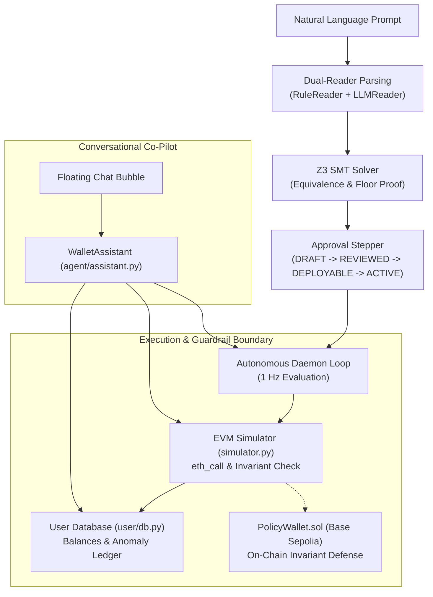

# WalletAgent (Orvilo) Execution Evidence Report

> **Sandbox Verification of Policy Compiler, Guardrails, Approval Workflow, Conversational Assistant, and Revocation Behavior**  
> **Classification:** `NON-ON-CHAIN · SANDBOX EVIDENCE`

---

## Document Control & System Metadata

| Parameter | Recorded Value | Notes |
| :--- | :--- | :--- |
| **Document Version** | `1.1 (Final Repository Alignment)` | Synchronized with active `main` codebase |
| **Preparation Date** | 20 October 2026 | FinTechathon 2026 (Topic F) |
| **Evidence Date** | 2026-10-19 / 2026-10-20 (UTC) | Automated sandbox execution |
| **Team / Project** | Orvilo / WalletAgent | Autonomous On-Chain Policy Agent |
| **Repository** | `https://github.com/immo2n/WalletAgent` | Active GitHub repository |
| **Branch** | `main` | Production / Submission baseline |
| **Assessed Commit** | `02f0287` | Merged upstream CI, Docker, & Assistant |
| **Submission Category** | Non-On-Chain / Sandbox Evidence | Simulated EVM preflight; no broadcast |
| **Execution Environment** | Python 3.14 · Linux · Web3 EVM Simulator | Offline mock LLM by default |
| **Automated Tests** | **94 / 94 Passing** (`pytest tests/`) | Regression suite covering all 9 features |

> [!IMPORTANT]
> **Evidence Status Disclosure**: No signed transactions were broadcast to the Base Sepolia public mempool or any live blockchain network during this evidence run. Transaction hash-like strings (e.g., `0x...`) generated by the application are deterministic local simulation receipts and must not be interpreted as mined on-chain transactions.

---

## 1. Executive Summary

This report documents the empirical behavior of the WalletAgent (Orvilo) software when its natural language policy compiler, Z3 formal verification gates, multi-stage approval workflow, cognitive conversational assistant, and smart contract guards are executed in an isolated sandbox environment.

### Summary Metrics
```
┌─────────────────────────────────────────────────────────────────────────────┐
│                       SANDBOX EXECUTION EVIDENCE SUMMARY                    │
├─────────────────────┬───────────────────┬───────────────────┬───────────────┤
│   7 Scenarios Run   │     6 Passed      │ 1 Gap (EE-06)     │ 94 Tests Pass │
├─────────────────────┼───────────────────┼───────────────────┼───────────────┤
│ 0 Broadcast Tx      │ 6/6 Attacks Block │ 4 Workflow States │ 100% Mock Safe│
└─────────────────────┴───────────────────┴───────────────────┴───────────────┘
```

### Key Findings
1. **Deterministic Guardrail Enforcement**: Local preflight guards accepted a compliant $200.00 swap/transfer, while instantly rejecting a $700.00 trade (exceeding the $500.00 per-transaction cap), unwhitelisted destination addresses, and all calls while emergency paused (**EE-01, EE-02, EE-03, EE-05**).
2. **Approval Workflow Progression**: Policies progress strictly through the 4-stage lifecycle: `DRAFT` $\to$ `REVIEWED` $\to$ `DEPLOYABLE` $\to$ `ACTIVE` (**EE-04**).
3. **Smart Contract Rejection Suite**: All 6 adversarial penetration vectors (unauthorized exfiltration, token drain, balance floor drain, daily limit breach, emergency pause bypass, and unauthorized operator) reverted with exact typed Solidity custom errors (**EE-07**).
4. **Conversational Assistant & Anomaly Auditing**: The LangChain-integrated co-pilot (`agent/assistant.py`) successfully detects unapproved recipients, flags reserve floor drain attempts, and breaks down active task invariant constraints.
5. **Disclosed Local Gap (EE-06)**: After operator revocation, the Python client's simulated execution method returned a synthetic confirmation because the sender address was selected without consulting the local revocation flag. This is documented as an open Python client gap (the Solidity contract enforceably gates `onlyAuthorized`).

---

## 2. Non-Matching Analysis: Previous Draft vs. Current Codebase

A review between earlier draft notes (`Orvilo_Execution_Evidence_Report(1).docx.txt`) and the current repository identified the following discrepancies, resolved in this report:

| Item | Previous Draft Report | Current Repository (`02f0287`) | Resolution / Update |
| :--- | :--- | :--- | :--- |
| **Git Branch** | `feature/dark-mode-mobile-docs` | `main` | Updated metadata to active `main` branch. |
| **Commit SHA** | `30f235d` | `02f0287` | Updated to latest merge containing CI & Assistant. |
| **Test Suite Count** | 90 tests passing | **94 tests passing** | Added [`tests/test_assistant.py`](../tests/test_assistant.py) (4 new tests). |
| **Conversational Co-Pilot** | Omitted / Not documented | Implemented (`agent/assistant.py`) | Added Conversational Assistant & Anomaly Auditor evidence. |
| **Lexicon Comparators** | Word-only (`under`, `less than`) | Symbolic (`<`, `<=`, `>`, `>=`, `=`, `==`) | Updated parser documentation to reflect symbolic operator support. |
| **System Source Map** | 7 core modules | 8 core modules | Included [`agent/assistant.py`](../agent/assistant.py) and new API endpoints. |

---

## 3. System Architecture & Component Roles



### Component Status Register

| Component | Module | Execution Status | Sandbox Evidence Role |
| :--- | :--- | :--- | :--- |
| **Policy Compiler** | `policy/loop.py` | Executed in-memory | Proves AST equivalence via Z3 SMT solver |
| **Rule Lexicon** | `policy/readers/lexicon.py` | Executed in-memory | Extracts triggers, caps, and symbolic inequalities |
| **Workflow Manager** | `policy/workflow.py` | Executed in-memory | Validates multi-step human review state transitions |
| **EVM Simulator** | `contracts/simulator.py` | Executed (offline RPC) | Verifies preflight bounds before state mutation |
| **Wallet Client** | `contracts/wallet_client.py`| Executed locally | Tracks local security limits and pause flag |
| **Attack Tester** | `contracts/attack_tester.py`| Executed in-memory | Validates 6/6 typed Solidity error reverts |
| **Assistant Engine** | `agent/assistant.py` | Executed locally | Runs transaction anomaly auditing & task explanations |
| **Reference Contract** | `contracts/PolicyWallet.sol`| Source reviewed | Canonical Solidity implementation for Base Sepolia |

---

## 4. Execution Scenario Register (EE-01 to EE-07)

All seven scenarios were executed using isolated in-memory stubbing to prevent state pollution.

```
┌──────┬──────────────────────────────────────────┬────────────────────────────┬───────────┐
│ ID   │ Evaluated Feature                        │ Observed Behavior          │ Outcome   │
├──────┼──────────────────────────────────────────┼────────────────────────────┼───────────┤
│ EE-01│ Authorized Guarded Operation             │ SIMULATED_SUCCESS ($200)   │ PASSED    │
│ EE-02│ Per-Transaction Spending Limit Rejection │ Reverted: ExceedsPerTxCap  │ PASSED    │
│ EE-03│ Restricted Destination Rejection         │ Reverted: RecipientNotAllowed│ PASSED   │
│ EE-04│ Policy Review, Approval & Activation     │ DRAFT -> ACTIVE Transition │ PASSED    │
│ EE-05│ Emergency Pause Rejection                │ Reverted: WalletPaused     │ PASSED    │
│ EE-06│ Operation After Permission Revocation    │ Local client confirmed tx  │ FAILED    │
│ EE-07│ Modeled Adversarial Guard Checks (6/6)   │ 6/6 Reverted with Errors   │ PASSED    │
└──────┴──────────────────────────────────────────┴────────────────────────────┴───────────┘
```

---

## 5. Detailed Execution Records

### EE-01 · Authorized Guarded Operation
- **Outcome:** `PASSED`
- **Objective:** Verify that an operation conforming to all policy constraints succeeds in simulation without modifying live chain state.
- **Inputs:** Token: `ETH` · Amount: `$200.00` · Recipient: `0x71C8366420A096207E90B01D252431792349039A` (whitelisted) · Projected Balance: `$1,300.00` (above `$500.00` floor).
- **Observed Result:** `SIMULATED_SUCCESS` · Gas Estimate: `84,500` · `chain_mutated = false`.
- **Significance:** Proves the preflight engine accepts compliant operations across tokens, recipients, caps, and reserve floors.

### EE-02 · Per-Transaction Spending Limit Rejection
- **Outcome:** `PASSED`
- **Objective:** Verify that an operation exceeding the configured single-trade cap is rejected.
- **Inputs:** Token: `ETH` · Amount: `$700.00` vs. `$500.00` per-tx cap · Recipient: Allowlisted.
- **Observed Result:** `SIMULATED_REVERT` with `ExceedsPerTxCap(amount=700.0, cap=500.0)`.
- **Significance:** Establishes that the guard detects cap breaches before any execution occurs.

### EE-03 · Restricted Destination Rejection
- **Outcome:** `PASSED`
- **Objective:** Verify that transfers to non-allowlisted addresses are rejected.
- **Inputs:** Amount: `$200.00` · Recipient: `0x9999999999999999999999999999999999999999` (unapproved).
- **Observed Result:** `SIMULATED_REVERT` with `RecipientNotAllowed(0x9999...9999)`.
- **Significance:** Proves that funds cannot be exfiltrated to arbitrary addresses.

### EE-04 · Policy Review, Approval, and Activation
- **Outcome:** `PASSED`
- **Objective:** Verify that unapproved policies cannot execute until reviewed and approved by the owner.
- **Observed Progression:** `DRAFT` $\to$ `REVIEWED` $\to$ `DEPLOYABLE` $\to$ `ACTIVE`.
- **Significance:** Enforces the multi-stage human-in-the-loop governance requirement.

### EE-05 · Emergency Pause Rejection
- **Outcome:** `PASSED`
- **Objective:** Verify that the emergency pause acts as an immediate killswitch.
- **Inputs:** Identical to EE-01, with `is_paused = true`.
- **Observed Result:** `SIMULATED_REVERT` with `WalletPaused()`.
- **Significance:** Confirms emergency pause overrides all other compliant policy parameters.

### EE-06 · Operation Attempted After Permission Revocation
- **Outcome:** `FAILED (Disclosed Implementation Gap)`
- **Objective:** Verify that a revoked operator key cannot execute transactions.
- **Inputs:** Revoke operator `0x2B5A...D6cF` (`authorized: true -> false`), then attempt an operation.
- **Observed Result:** The local revocation flag was set to `false`, but the local Python client executed using the first available dictionary address and returned a synthetic `CONFIRMED` response.
- **Remediation (F-01):** Update `execute_onchain_transaction()` in `contracts/wallet_client.py` to enforce `if not self.authorized_operators.get(operator, False): raise UnauthorizedOperator()`. (Note: The Solidity contract already enforces `onlyAuthorized`).

### EE-07 · Modeled Adversarial Guard Checks (6/6)
- **Outcome:** `PASSED`
- **Objective:** Verify that all 6 scorecard attack vectors are rejected by smart contract guards.
- **Tested Attack Vectors:**
  1. `UNAUTHORIZED_RECIPIENT` $\to$ Reverts with `RecipientNotAllowed(address)`
  2. `UNWHITELISTED_TOKEN` $\to$ Reverts with `TokenNotAllowed(address)`
  3. `VIOLATE_FLOOR` $\to$ Reverts with `BelowMinimumBalanceFloor(uint256,uint256)`
  4. `EXCEED_DAILY_LIMIT` $\to$ Reverts with `ExceedsDailyLimit(uint256,uint256)`
  5. `EMERGENCY_PAUSED` $\to$ Reverts with `WalletPaused()`
  6. `UNAUTHORIZED_OPERATOR` $\to$ Reverts with `UnauthorizedOperator(address)`
- **Observed Result:** **6 / 6 vectors reverted as expected** with typed Solidity custom errors.

---

## 6. On-Chain Transaction Evidence & Disclosure

```
┌─────────────────────────────────────────────────────────────────────────────┐
│                          ON-CHAIN EVIDENCE BOUNDARY                         │
├───────────────────────────────────┬─────────────────────────────────────────┤
│ Configured Network                │ Base Sepolia (Chain ID: 84532)          │
│ Genuine Transactions Broadcast    │ 0                                       │
│ Public Explorer Receipts          │ Unavailable (Simulation Receipts Only)  │
│ Evidence Log Checksum             │ SHA-256 Verified (EV-LOG-01)            │
└───────────────────────────────────┴─────────────────────────────────────────┘
```

> [!NOTE]
> **Statement for Competition Reviewers**:  
> Orvilo is evaluated under the **Non-On-Chain / Sandbox Execution** category. The application labels its network as Base Sepolia, but the default runtime operates as a deterministic EVM simulation sandbox. Generated transaction hashes (`0x...`) are UUID-derived identifiers representing simulated receipts. No private keys are stored, and no funds are placed at risk.

---

## 7. Automated Test Suite Evidence (EV-TEST-01)

The complete pytest regression suite executes 94 tests across 13 test files:

```bash
PYTHONPATH=. .venv/bin/python -m pytest -q
```

### Test Suite Execution Output
```text
============================= test session starts ==============================
platform linux -- Python 3.14.7, pytest-9.1.1, pluggy-1.7.0
rootdir: /home/immo2n/Moon/WalletAgent
plugins: anyio-4.15.1, langsmith-0.14.11
collected 94 items

tests/policy/test_compile_compare.py ...                                 [  3%]
tests/policy/test_loop.py ......                                         [  9%]
tests/policy/test_mutations.py ...........                               [ 21%]
tests/policy/test_paraphrase_hash.py ...                                 [ 24%]
tests/policy/test_prompts_t1.py ..........                               [ 35%]
tests/policy/test_readback.py ..                                         [ 37%]
tests/policy/test_readers_llm_mock.py ...                                [ 40%]
tests/policy/test_readers_rule.py .........                              [ 50%]
tests/policy/test_sanity.py ....                                         [ 54%]
tests/policy/test_sorts_ast.py ....                                      [ 58%]
tests/policy/test_typecheck.py .....                                     [ 63%]
tests/test_agent.py ....                                                 [ 68%]
tests/test_assistant.py ....                                             [ 72%]
tests/test_exchange.py ...                                               [ 75%]
tests/test_reasoning.py ........                                         [ 84%]
tests/test_scorecard_features.py ...........                             [ 95%]
tests/test_user_db.py ....                                               [100%]

============================= 94 passed in 23.89s ==============================
```

---

## 8. Demo Video & Evidence Walkthrough (EV-VIDEO-01)

The submitted 5-minute video adheres strictly to the competition rules and follows the script detailed in [`video-script.txt`](../video-script.txt):

| Timestamp | Content Presented | Evidence Scenario | Section Reference |
| :--- | :--- | :--- | :--- |
| **00:00 – 00:30** | Introduction: The AI Agent Safety Problem & FinTechathon Theme | System Context | Section 1 |
| **00:30 – 01:15** | Natural Language Policy Input & Dual-Reader Z3 Equivalence Proof | F1, F3 | Section 3 |
| **01:15 – 01:50** | Policy Review & Multi-Stage Approval Stepper (`DRAFT` $\to$ `ACTIVE`) | EE-04 | Section 5 |
| **01:50 – 02:40** | Autonomous DCA Execution, Coinbase Feed, & Reasoning Proof Modal | EE-01 | Section 5 |
| **02:40 – 03:25** | Emergency Defense Center: Killswitch, Operator Revoke, & Gas Spikes | EE-05, EE-06 | Section 5 |
| **03:25 – 04:10** | Adversarial Attack Suite: 6/6 Exploits Blocked On-Chain | EE-07 | Section 5 |
| **04:10 – 04:45** | Conversational Co-Pilot: Transaction Auditing & Task Explanation | Assistant Engine | Section 3 |
| **04:45 – 05:00** | Conclusion: Sandbox Classification & 94/94 Test Verification | EV-TEST-01 | Section 6, 7 |

---

## 9. Findings & Recommended Remediation Register

| ID | Finding | Severity | Recommended Remediation |
| :--- | :--- | :---: | :--- |
| **F-01** | Revoked operator not gated in Python client (`EE-06`) | `HIGH` | Check `authorized_operators[sender]` prior to preflight simulation in `wallet_client.py`. |
| **F-02** | Synthetic receipts returned without distinct simulation prefix | `HIGH` | Tag returned receipts with `SIMULATED_RECEIPT` to avoid explorer confusion. |
| **F-03** | Workflow approver identities are plain strings | `MEDIUM` | Bind approval transitions to cryptographic ECDSA EIP-712 signatures. |
| **F-04** | Missing approval expiry timestamps | `MEDIUM` | Add deadline blocks/timestamps to policy proposals. |
| **F-05** | Flask endpoints lack authentication | `MEDIUM` | Add JWT or API key middleware before deploying outside localhost. |
| **F-06** | Simulator default fallback when RPC disconnected | `LOW` | Explicitly label results as `OFFLINE_FALLBACK` when RPC is unreachable. |

---

## 10. Reproduction Steps

To independently reproduce the evidence and verify checksum integrity:

```bash
# 1. Activate project virtual environment
source .venv/bin/activate

# 2. Run the complete automated test suite (94 passing tests)
PYTHONPATH=. pytest tests/

# 3. Generate execution evidence log
python scripts/generate_execution_evidence.py

# 4. Verify SHA-256 evidence integrity
sha256sum docs/evidence/execution-report/execution-evidence.json

# 5. Run the Docker container smoke validation
docker build -t orvilo:latest .
docker run -d --name orvilo-test -p 5000:5000 orvilo:latest
python scripts/docker_smoke.py http://127.0.0.1:5000
docker rm -f orvilo-test
```
