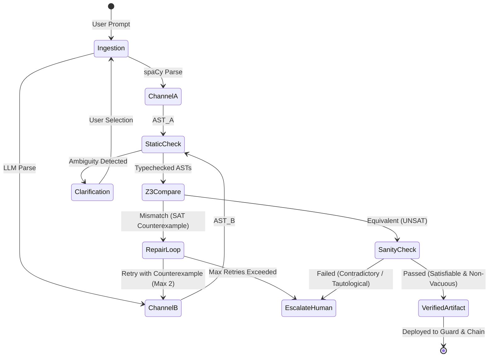

# Orvilo Policy Engine & Formal Verification Specification

> **Subsystem Specification**: Dual-Reader Natural Language Compilation, AST Verification, and Z3 SMT Solver Architecture
> **Repository Module**: [`policy/`](../policy/)
> **Key Architectural Principle**: *The LLM is an untrusted proposer; deterministic code and formal mathematical proofs form the security boundary.*

---

## 1. Architectural Overview & Problem Formulation

> **Verified implementation boundary:** The policy engine is deterministic around
> parsing, typing, Z3 compilation, comparison, sanity checks, hashing, and
> on-chain parameter export. The LLM reader is optional and untrusted. The
> default application uses the mock reader unless a Groq key is configured.

In conventional autonomous agent wallets, Large Language Models (LLMs) are directly entrusted with parsing financial instructions and broadcasting Web3 transactions. This creates severe vulnerability vectors:
1. **Semantic Hallucinations**: An LLM may misinterpret `"keep balance at least $500"` as checking balance *prior* to a trade rather than *post-execution*.
2. **Prompt Injection & Jailbreaks**: Adversarial instructions hidden in unverified token metadata, memo fields, or invoice strings can override prompt constraints.
3. **Dimensional Confusion**: Ambiguous numbers (e.g., `"gas under 5%"`) can cause dangerous execution when interpreted as raw gwei or absolute units.

Orvilo resolves this by introducing a **Dual-Channel Formal Verification Architecture** where natural language instructions must be independently synthesized by two isolated channels and formally proved mathematically equivalent via the Z3 SMT solver over physical domain bounds.

### Visual Architecture Flowchart
Below is the full policy verification pipeline rendered from [`visuals/rendered/policy-verification.png`](../visuals/rendered/policy-verification.png):


---

## 2. Dual-Reader Architecture

The policy compilation pipeline employs two independent, decoupled readers:

```
                                  [ User Prompt ]
                                         │
                 ┌───────────────────────┴───────────────────────┐
                 ▼                                               ▼
     [ Channel A: RuleReader ]                       [ Channel B: LLMReader ]
      - spaCy Dependency Parser                       - Schema-Constrained JSON
      - Typed Lexicon Mappings                        - Zero-Shot Semantic Synthesis
      - Deterministic & LLM-Free                     - Untrusted Proposer
                 │                                               │
                 ▼                                               ▼
          AST Expression A                                AST Expression B
                 │                                               │
                 └───────────────────────┬───────────────────────┘
                                         ▼
                            [ Static Typechecker ]
                             - Sort Inference
                             - Coercion Lattice
                                         │
                                         ▼
                         [ Z3 Equivalence Prover ]
                          - SMT Dual Assertion
                          - Counterexample Search
```

### 2.1 Channel A: Deterministic RuleReader
- **Module**: [`policy/readers/rule_reader.py`](../policy/readers/rule_reader.py)
- **Lexicon**: [`policy/readers/lexicon.py`](../policy/readers/lexicon.py)
- **Implementation**: Uses `spaCy` dependency tree parsing combined with explicit lexical token grammars. It operates deterministically without network calls or probabilistic inference.
- **Rule Extraction**:
  - Detects action verbs (`buy`, `swap`, `transfer`).
  - Identifies token symbols from curated registries (`ETH`, `WETH`, `USDC`).
  - Extracts numeric constraints, comparing against keywords: `at least`, `no more than`, `under`, `floor`, `cap`.
  - Captures trigger states: gas ceilings (`gas <= 20 gwei`), price triggers, and schedule intervals.

### 2.2 Channel B: Untrusted LLMReader
- **Module**: [`policy/readers/llm_reader.py`](../policy/readers/llm_reader.py)
- **JSON Schema**: [`policy/schema.py`](../policy/schema.py)
- **Role**: Handles linguistic variance, conversational phrasing, synonyms, and complex colloquial syntax.
- **Constraint**: Output is strictly constrained to a Draft-07 JSON Schema. If the LLM generates unparseable JSON or fields outside the schema, the output is rejected immediately before reaching the SMT solver.

---

## 3. Abstract Syntax Tree (AST) & Type System

### 3.1 Frozen AST Dataclasses
The formal AST is declared in [`policy/ast.py`](../policy/ast.py) using immutable, frozen Python dataclasses with exact arithmetic representations (`fractions.Fraction`):

```python
@dataclass(frozen=True)
class Policy:
    action: Action
    trigger: Optional[Expr]
    constraints: Tuple[Expr, ...]
    controls: Tuple[Expr, ...]
    raw_text: str = ""

@dataclass(frozen=True)
class Cmp(Expr):
    op: Literal["<", "<=", ">", ">=", "==", "!="]
    left: Expr
    right: Expr

@dataclass(frozen=True)
class BinOp(Expr):
    op: Literal["+", "-", "*", "/"]
    left: Expr
    right: Expr

@dataclass(frozen=True)
class Var(Expr):
    name: str

@dataclass(frozen=True)
class Const(Expr):
    val: Fraction
    unit: str  # "USD", "GWEI", "ETH", "USDC", "PERCENT", "NONE"
```

### 3.2 Dimensional Sorts & Type Checking
- **Module**: [`policy/sorts.py`](../policy/sorts.py) and [`policy/typecheck.py`](../policy/typecheck.py)
- To prevent catastrophic dimensional mismatch (e.g. comparing Gwei to USD or subtracting percentages from raw tokens), the engine implements a static typechecker over physical sorts:
  - `Sort.USD`: Fiat monetary denomination.
  - `Sort.GWEI`: Gas price measurement.
  - `Sort.PERCENT`: Dimensionless ratio ($0.0 \le r \le 1.0$).
  - `Sort.TOKEN`: Cryptographic asset units.
  - `Sort.BOOL`: Boolean logical propositions.

#### Coercion Matrix
Defined in [`policy/coercions.py`](../policy/coercions.py), scalar arithmetic is restricted to physically sound combinations:
$$\text{Sort.USD} \times \text{Sort.PERCENT} \longrightarrow \text{Sort.USD}$$
$$\text{Sort.USD} + \text{Sort.USD} \longrightarrow \text{Sort.USD}$$
$$\text{Sort.GWEI} \lessgtr \text{Sort.GWEI} \longrightarrow \text{Sort.BOOL}$$
$$\text{Sort.USD} \lessgtr \text{Sort.GWEI} \longrightarrow \mathbf{TypeError}\text{ (Unit Mismatch)}$$

---

## 4. Formal Equivalence & Z3 SMT Verification

### 4.1 Mathematical Formulation
Let $\Phi_A(\vec{x})$ represent the first-order logical formula compiled from Reader A (Deterministic Parser), and $\Phi_B(\vec{x})$ represent the formula compiled from Reader B (LLM Synthesizer), where $\vec{x}$ is the vector of system variables:
$$\vec{x} = \langle \text{gas}, \text{trade}, \text{balance after}, \text{balance before}, \text{daily spent} \rangle$$

The Z3 SMT solver seeks to prove semantic equivalence under all valid environmental states:
$$\forall \vec{x} \in \mathcal{D}_{\text{physical}}, \quad \Phi_A(\vec{x}) \iff \Phi_B(\vec{x})$$

To verify this via refutation, Z3 constructs the negation:
$$\Psi_{\text{mismatch}} = \mathcal{D}_{\text{physical}} \land \neg \left( \Phi_A(\vec{x}) \iff \Phi_B(\vec{x}) \right)$$

$$\Psi_{\text{mismatch}} \equiv \mathcal{D}_{\text{physical}} \land \left( (\Phi_A \land \neg \Phi_B) \lor (\neg \Phi_A \land \Phi_B) \right)$$

- **Case 1: `UNSAT` (Unsatisfiable)**:
  No assignment of variables can cause Channel A and Channel B to disagree. The policies are **provably identical**. Status: `VERIFIED`.
- **Case 2: `SAT` (Satisfiable)**:
  Z3 discovers a concrete model $\vec{x}^*$ satisfying $\Psi_{\text{mismatch}}$. This model is an exact **counterexample** where one policy allows a trade and the other forbids it.

### 4.2 Z3 Compilation Engine
- **Module**: [`policy/z3_compile.py`](../policy/z3_compile.py)
- All arithmetic operations are mapped to Z3's exact `Real` sort, preventing floating-point rounding inaccuracies.
- Domain constraints $\mathcal{D}_{\text{physical}}$ enforce realistic boundaries:
  $$0 \le \text{gas} \le 10{,}000 \text{ Gwei}$$
  $$0 \le \text{trade} \le 1{,}000{,}000 \text{ USD}$$
  $$0 \le \text{balance after} \le 10{,}000{,}000 \text{ USD}$$

### 4.3 Counterexample Feedback & Auto-Repair Loop
- **Module**: [`policy/compare.py`](../policy/compare.py) and [`policy/loop.py`](../policy/loop.py)
- When a counterexample is extracted (e.g. `trade_amount = $350, balance_after = $450`), it is serialized into structured JSON and fed back to Channel B in an automated repair prompt:
  > *"Your parsed policy allows a trade of $350 leaving a balance of $450, but the rule parser forbids this because the balance floor is $500. Fix your constraint formulation."*
- Channel B is granted up to **2 automated repair attempts**.
- If equivalence is still not reached after 2 retries, the system **fails closed** and routes the proposal to `NEEDS_HUMAN_REVIEW`.

---

## 5. Sanity Verification (Triviality & Vacuity Checking)

Before a verified policy is accepted, [`policy/sanity.py`](../policy/sanity.py) runs three formal safety checks:

1. **Satisfiability Check ($\exists \vec{x} : \Phi(\vec{x})$)**:
   Proves that the policy is not inherently self-contradictory. For example, `"gas < 10 gwei AND gas > 50 gwei"` is unsatisfiable ($UNSAT$) and would deadlock the wallet forever.
2. **Non-Vacuity Check ($\exists \vec{x} : \neg \Phi(\vec{x})$)**:
   Proves that the policy is not a tautology. For example, `"trade >= 0 USD"` is always true and provides zero protection.
3. **Redundancy Analysis**:
   Identifies subsumed constraints (e.g., `trade <= 100` and `trade <= 300`) and removes unneeded predicates.

---

## 6. Cryptographic Hashing & Controlled Readback

### 6.1 Canonical SHA-256 Policy Hashing
- **Module**: [`policy/hashing.py`](../policy/hashing.py)
- The AST is serialized into a canonical, alphabetically sorted JSON structure.
- A cryptographic hash is calculated:
  $$\mathcal{H}_{\text{policy}} = \text{SHA-256}(\text{CanonicalJSON}(\text{AST}))$$
- The SHA-256 hash identifies the canonical verified AST. The local wallet
client stores that hash in its in-memory security state; a deployed Solidity
contract would need an independently verified policy-hash check before this
could be called on-chain binding.

### 6.2 Controlled Natural Language Readback
- **Module**: [`policy/readback.py`](../policy/readback.py)
- Generates a deterministic, unambiguous English sentence directly from the compiled AST.
- **Round-Trip Property**: Passing the generated readback string back through Reader A reproduces the exact same AST and hash:
  $$\text{ReaderA}(\text{Readback}(\text{AST})) \equiv \text{AST}$$

---

## 7. Verification Loop State Machine

The complete state transitions managed by [`policy/loop.py`](../policy/loop.py) are:



---

## 8. Summary of Source Code Cross-References

| Component | File Path | Key Functions / Classes |
| :--- | :--- | :--- |
| **AST Definitions** | [`policy/ast.py`](../policy/ast.py) | `Policy`, `Cmp`, `BinOp`, `Const`, `Var` |
| **Dimensional Sorts** | [`policy/sorts.py`](../policy/sorts.py) | `Sort`, `infer_sort()`, `sort_compatible()` |
| **Type Checker** | [`policy/typecheck.py`](../policy/typecheck.py) | `Typechecker`, `typecheck_policy()` |
| **Rule Reader** | [`policy/readers/rule_reader.py`](../policy/readers/rule_reader.py) | `RuleReader`, `parse_prompt()` |
| **LLM Reader** | [`policy/readers/llm_reader.py`](../policy/readers/llm_reader.py) | `LLMReader`, `parse()` |
| **Z3 Compiler** | [`policy/z3_compile.py`](../policy/z3_compile.py) | `Z3Compiler`, `compile_policy()` |
| **Equivalence Prover** | [`policy/compare.py`](../policy/compare.py) | `compare_policies()`, `extract_counterexample()` |
| **Sanity Checker** | [`policy/sanity.py`](../policy/sanity.py) | `verify_sanity()`, `check_satisfiable()` |
| **Policy Hashing** | [`policy/hashing.py`](../policy/hashing.py) | `policy_hash()`, `canonical_json()` |
| **Workflow Manager** | [`policy/workflow.py`](../policy/workflow.py) | `PolicyWorkflowManager`, `PolicyProposal` |
