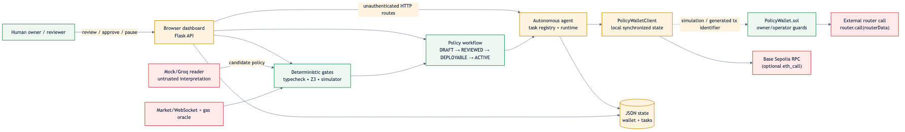
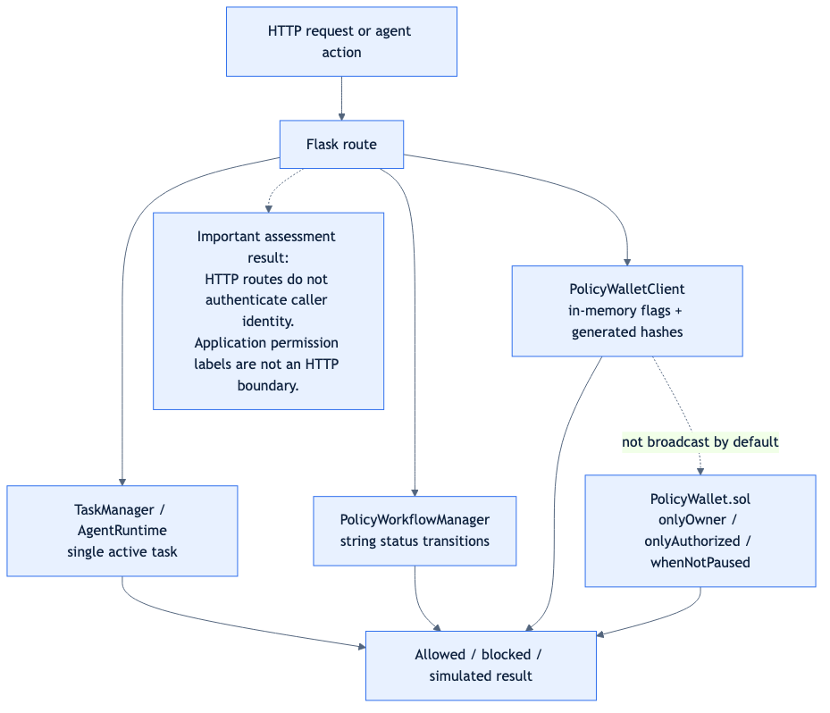

# Orvilo: User-Defined On-Chain Guardrails for Autonomous AI Wallets

## Security Self-Assessment Report

**Report status:** Final self-assessment; not an independent audit
**Assessment date:** 19 October 2026
**Report version:** 1.0
**Assessor:** Orvilo engineering team / repository self-assessment
**Repository:** `https://github.com/immo2n/WalletAgent`
**Branch assessed:** `feature/dark-mode-mobile-docs`
**Assessed code commit:** `01ff873` (`Document Docker image sharing workflow`)
**Assessment environment:** Local Docker and Python test execution; Base Sepolia configuration is documented, but no live transaction was broadcast during this assessment.

> **Evidence convention.** “Designed” means described as an intended control. “Implemented” means present in the current source. “Verified” means exercised by an automated test or the Docker smoke test. A control is not treated as verified merely because a comment, UI label, generated hash, or simulated response claims it is active.

## Document control

| Version | Date | Change | Author |
|---|---:|---|---|
| 1.0 | 2026-10-19 | Initial final self-assessment covering permission tiers and known risks | Orvilo engineering |

### Contents

1. Executive summary
2. Assessment scope and system identification
3. Methodology and rating criteria
4. Security architecture and threat model
5. Security requirements and verification criteria
6. Key custody, signing authority, and administrative privileges
7. Permission-tier implementation and enforcement
8. Authentication, authorization, and account isolation
9. Transaction authorization and execution lifecycle
10. Autonomous agent and tool security
11. Wallet and smart contract security
12. Financial logic, spending limits, and blockchain state
13. Application, API, and data security
14. Infrastructure, dependencies, and external services
15. Security test register and evidence
16. Known risks, findings, and residual exposure
17. Remediation, risk acceptance, and retesting
18. Monitoring, incident response, and recovery
19. Conclusion and limitations
20. Appendices and references

## 1. Executive summary

Orvilo is a simulation-first Flask application that converts natural-language trading constraints into a typed policy, compares deterministic and LLM-derived interpretations, applies Z3-backed checks, records a human-review workflow, and runs a local autonomous task loop. It includes a Solidity reference contract named `PolicyWallet` with owner/operator authorization, policy hashes, token and recipient allowlists, spending caps, reserve floors, pause, and allowance-revocation functions.

The assessed deployment is **local simulation by default**. The Docker image sets `LLM_PROVIDER=mock`; the application uses JSON state and the contract client returns generated transaction identifiers instead of signing and broadcasting transactions. The configured network is Base Sepolia (`84532`), but no genuine on-chain transaction hash, receipt, signer operation, or deployed-contract state was verified in this assessment.

### Outcome

| Area | Outcome |
|---|---|
| Policy parsing and deterministic guard logic | Implemented and verified by the 90-test suite and Docker smoke test |
| Human-review workflow | Implemented in application memory; verified for happy-path API transitions |
| Solidity access modifiers and guard functions | Present in reviewed source; not verified against a deployed bytecode address |
| Permission tiers | Partly implemented: owner/operator are modeled; HTTP/API enforcement is absent |
| Authentication and account isolation | Not implemented; all Flask routes are reachable without identity proof |
| Real signing and blockchain execution | Not implemented in the default path; generated hashes are not evidence of chain execution |
| Production readiness | Not suitable for real funds without remediation of the critical and high risks below |

The principal risks are unauthenticated administrative and wallet-mutating routes, a contract execution design that accepts caller-supplied USD and post-balance values and performs arbitrary router calls, synthetic rather than cryptographic approval/signing in the default client, and fallback behavior that can make simulated execution appear successful when RPC or deployment state is unavailable.

## 2. Assessment scope and system identification

### In scope

| Component | Evidence |
|---|---|
| Flask dashboard and API | [flask/server.py](../flask/server.py) |
| Policy AST, readers, type checking, Z3 comparison, hashing | [policy/](../policy/) |
| Approval workflow | [policy/workflow.py](../policy/workflow.py) |
| Agent runtime and task persistence | [agent/runtime.py](../agent/runtime.py), [agent/task.py](../agent/task.py) |
| Wallet and transaction JSON persistence | [user/db.py](../user/db.py), [user/models.py](../user/models.py) |
| EVM simulator and attack tester | [contracts/simulator.py](../contracts/simulator.py), [contracts/attack_tester.py](../contracts/attack_tester.py) |
| Solidity reference contract and ABI | [contracts/PolicyWallet.sol](../contracts/PolicyWallet.sol), [contracts/abi.py](../contracts/abi.py) |
| Contract client, Docker, Compose, CI | [contracts/wallet_client.py](../contracts/wallet_client.py), [Dockerfile](../Dockerfile), [docker-compose.yml](../docker-compose.yml), [ci.yml](../.github/workflows/ci.yml) |
| Market and gas integrations | [exchange/](../exchange/) |

### Identifiers and deployment facts

| Item | Current value or status |
|---|---|
| Runtime | Python 3.13 Docker base; Flask development server |
| Network configuration | Base Sepolia, chain ID 84532 |
| RPC | `https://sepolia.base.org` in the example configuration |
| Contract address | `0x89D24A6b4CcB1B6fAA2625fE562bDD9a23260359` is a client default; deployment and bytecode correspondence were not independently verified |
| LLM | Mock by default; Groq adapter is optional |
| Persistence | Local JSON files; no transactional database or migration system |
| Authentication | No login, session, bearer-token, wallet-signature, or API-key gate in Flask routes |
| Excluded evidence | No private keys, production secrets, deployed owner configuration, live receipts, or mainnet activity were available |

## 3. Assessment methodology and rating criteria

The assessment used:

1. Source review of routes, state stores, policy workflow, task runtime, contract client, Solidity, Docker, Compose, CI, and configuration.
2. Review of existing unit tests and the repository smoke test.
3. Execution of `python -m pytest -q` in the project environment: **90 passed**.
4. Fresh Docker build and container execution.
5. Execution of `scripts/docker_smoke.py`, which passed for dashboard, market/SSE, wallet, transactions/reasoning, policy lifecycle, agent controls, simulation, contract controls, attack vectors, assistant chat, and reset.
6. Manual comparison of application claims with actual implementation behavior.

No formal penetration test, fuzzing campaign, dependency vulnerability scan, private-key review, deployed bytecode verification, or independent smart-contract audit was performed.

### Rating definitions

| Dimension | Meaning |
|---|---|
| Likelihood | Low: difficult or constrained; Medium: plausible with access; High: directly reachable or reproducible |
| Impact | Low: limited integrity/availability effect; Medium: material application effect; High: policy, identity, or fund-control effect |
| Severity | Combined prioritization for remediation; Critical means a direct path to unauthorized value movement or complete control |
| Confidence | Evidence confidence from 1/10 to 10/10; confidence is not exploit likelihood |

## 4. Security architecture and threat model

Source: [security-trust-boundaries.mmd](../visuals/security-trust-boundaries.mmd).

### Assets

- Wallet balances and transaction history.
- Active policy hash, caps, allowlists, reserve floor, and pause state.
- Owner/operator authority and any future signing keys.
- Policy proposals, reviews, approvals, and deployment records.
- Market and gas data used by execution decisions.
- API availability and integrity of JSON state.

### Actors and capabilities

- **Human owner:** intended policy administrator and emergency controller.
- **Reviewer/approver:** intended human-in-the-loop policy participant.
- **Autonomous operator:** intended limited executor.
- **Unauthenticated HTTP caller:** actual capability in the current Flask deployment; can call routes directly.
- **LLM/external market source:** untrusted or failure-prone input to interpretation and decision support.
- **RPC/router:** external dependency; may be unavailable, stale, malicious, or mismatched with local assumptions.

### Trust boundaries

The most important boundary is between the browser/API and administrative state. It is not protected by authentication. A second boundary is between the Python client’s local synchronized state and the Solidity contract: the default client does not establish that its generated responses correspond to chain state. A third boundary is between the authorized contract operator and arbitrary router calldata in `executeSwap`.

## 5. Security requirements and verification criteria

| ID | Security requirement | Implementation evidence | Verification |
|---|---|---|---|
| SR-01 | Only owner can change policy or emergency state | Solidity `onlyOwner` functions in [PolicyWallet.sol](../contracts/PolicyWallet.sol) | Source-reviewed; deployed enforcement not verified |
| SR-02 | Operator actions are bounded by policy | `_verifyGuards`, caps, allowlists, pause | Source-reviewed; local simulator and attack tests exercised |
| SR-03 | Policy interpretation is independently checked | Rule reader, LLM reader, Z3 comparison | 90-test suite and smoke test passed |
| SR-04 | Human approval precedes deployment | `PolicyWorkflowManager` states | Happy path verified; caller identity not authenticated |
| SR-05 | Unauthorized HTTP callers cannot mutate wallet or policy | Required for production | **Failed: no HTTP authentication/authorization layer** |
| SR-06 | Execution values are derived from trusted chain state | Required for financial safety | **Failed in contract design: USD and post-balance values are caller inputs** |
| SR-07 | Revocation blocks future execution | Contract invalidation/revoke functions and local flags | Local behavior tested; live transaction and queued-task race not verified |
| SR-08 | Transaction hashes and receipts represent real chain execution | Required for auditability | **Not implemented in default client; hashes are generated identifiers** |
| SR-09 | Account data is isolated by authenticated owner | Required for multi-user service | **Failed/not implemented: single local state and no identity boundary** |
| SR-10 | Secrets are not baked into image or repository | `.dockerignore`, mock defaults | Docker context excludes `.env`; secret rotation and runtime secret governance not verified |

## 6. Key custody, signing authority, and administrative privileges

The example configuration names `AGENT_PRIVATE_KEY` and `OWNER_ADDRESS`, but the default local path does not load a signer for transaction submission. The contract client creates UUID-derived strings with a `0x` prefix for `tx_hash`; these are not cryptographic transaction hashes and do not prove a signature, broadcast, inclusion, or receipt.

The Solidity reference contract has:

- An immutable `owner`.
- `onlyOwner` for policy updates, operator management, allowance revocation, pause, unpause, and invalidation.
- `onlyAuthorized` for guarded execution, allowing owner or an authorized operator.
- No upgrade proxy in the reviewed contract.
- No on-chain nonce or replay domain in the reviewed execution functions.

The application layer exposes routes that call analogous operations without proving that the requester is the owner. The apparent owner/operator addresses in [wallet_client.py](../contracts/wallet_client.py) are constants in local state, not authenticated identities.

## 7. Permission-tier implementation and enforcement verification

Source: [permission-enforcement.mmd](../visuals/permission-enforcement.mmd).

### Implemented or modeled tiers

| Tier | Intended holder | Allowed actions | Restrictions | Enforcement location | Status |
|---|---|---|---|---|---|
| Owner | Human wallet owner | Set/invalidate policy, manage operators, pause/unpause, revoke allowances | Highest privilege | Solidity `onlyOwner`; application route has no identity check | Implemented in contract source; API enforcement failed |
| Authorized operator | Autonomous agent or designated executor | Guarded swap/transfer | Policy hash, token/recipient allowlists, per-tx cap, daily cap, reserve floor, pause | Solidity `onlyAuthorized` + `_verifyGuards`; local client mirrors flags | Implemented in reference contract; live deployment unverified |
| Reviewer | Human security reviewer | Mark proposal reviewed | Intended precondition for approval | String field `reviewed_by` in workflow | Modeled, not authenticated |
| Approver | Human owner/approver | Mark proposal deployable | Intended human approval and signature | Status and generated signature in workflow | Modeled; cryptographic approval not verified |
| Agent runtime | Local autonomous loop | Monitor and attempt task execution | Single active task; local policy/task checks | [agent/runtime.py](../agent/runtime.py), [agent/task.py](../agent/task.py) | Implemented and locally tested |
| Public HTTP caller | Any network client | Actual caller of every exposed route | None in Flask layer | No middleware or route guard | **Unrestricted; critical boundary gap** |

### Required enforcement questions

| Question | Answer |
|---|---|
| Who receives each permission? | Owner/operator addresses are constants in the client and constructor inputs in Solidity; reviewer/approver are request fields |
| Which component enforces it? | Solidity modifiers enforce the reference contract; Flask and workflow do not authenticate the identity field |
| Are direct API calls restricted? | No. Mutating routes accept JSON without authentication |
| Are direct contract calls restricted? | Reference contract restricts owner/operator functions, but the deployed address/code relationship was not verified |
| Who can elevate permissions? | Solidity owner can authorize operators; in the API, any caller can invoke routes that mutate local state |
| How was it verified? | Source review, unit tests, and Docker smoke happy paths; no adversarial authenticated/unauthenticated matrix was present |

## 8. Authentication, authorization, and account isolation

No login, session, bearer token, API key, wallet-signature challenge, CSRF protection, or per-account ownership check was found in [server.py](../flask/server.py). Routes such as wallet mutation, transaction creation, reset, policy review/approval/deployment, pause/unpause, operator revocation, allowance revocation, policy invalidation, agent pause/resume, and assistant actions are callable by a client that can reach the Flask server.

The application is a single-user local simulation, which explains the design, but that boundary must not be mistaken for authorization. If exposed beyond a trusted local machine, the API permits unauthorized state changes and cross-user access by construction.

## 9. Transaction authorization and execution lifecycle

The intended lifecycle is:

1. Natural-language prompt enters `/api/verify`.
2. Deterministic and untrusted-reader interpretations are compared.
3. A proposal is created in `DRAFT`.
4. Review and approval endpoints change status.
5. Deployment syncs policy parameters to the local contract client and registers an agent task.
6. Runtime evaluates market, gas, balance, and policy conditions.
7. The simulator returns an allowed/reverted result; default client methods produce generated identifiers.

The workflow implementation permits `deploy_policy` from `DRAFT`, `REVIEWED`, or `DEPLOYABLE`, despite the documented human-in-the-loop intent. Approval signatures are generated strings when no signature is supplied. There is no authenticated binding between `reviewed_by`/`approved_by` and a key, no expiry, no nonce, no immutable approval payload, and no verified pre-submission chain-state reconciliation in the default path.

## 10. Autonomous agent and tool security

The agent has a single-task constraint and pause/resume controls. These are useful safety mechanisms and were exercised by the Docker smoke test. They are not an authorization boundary because the controlling routes are unauthenticated and JSON task state is writable by the application process.

The LLM is described as untrusted and is compared with deterministic parsing. This reduces interpretation risk, but it does not protect against unauthorized API invocation, malicious market/RPC responses, or a future tool being granted broader credentials. Prompt injection and malicious external content were not subjected to a dedicated adversarial test campaign.

## 11. Wallet and smart contract security

### Positive controls found

- `onlyOwner`, `onlyAuthorized`, and `whenNotPaused` modifiers.
- Policy hash comparison.
- Token and recipient allowlists.
- Per-transaction and daily caps.
- Minimum balance floor.
- Emergency pause and operator revocation.
- Custom errors and event emission.
- Local attack vectors and simulator coverage.

### Material weaknesses

`executeSwap` accepts an arbitrary `router` and arbitrary `routerData`, then executes `router.call`. The contract does not constrain the router to an approved address, does not independently derive USD value or post-trade balance, and does not enforce the returned amount against `minAmountOut` after the arbitrary call. `executeTransfer` also trusts caller-provided USD and balance values. These are critical design concerns for any real deployment.

The reviewed source is a reference contract, not proof of the bytecode at the configured address. No deployment artifact, verified source match, transaction receipt, or live owner/operator state was supplied.

## 12. Financial logic, spending limits, and blockchain state

The intended calculations include:

- `balanceAfter = current USDC balance - trade USD`.
- `ethPurchased = trade USD / ETH price`, rounded to five decimals in the local simulation.
- Daily spend reset by `block.timestamp / 1 days` in Solidity.
- Gas estimate and fee derived from estimated gas and a gas price, with deterministic fallback values.

The implementation does not establish token-decimal correctness for arbitrary ERC-20 tokens, oracle freshness, signed price provenance, slippage enforcement at the contract boundary, pending-transaction accounting, concurrency-safe chain reconciliation, replacement handling, reorganization handling, or failed-receipt reconciliation. USD values are caller or application inputs rather than a trusted on-chain valuation mechanism.

## 13. Application, API, and data security

The code uses JSON request parsing and typed conversions, but broad input validation is inconsistent. The application stores wallet and agent task state in local JSON files and uses in-process locks; this is not a durable transaction boundary for multiple workers or concurrent deployments. The reset endpoint deletes/reinitializes simulation state without authentication.

The Flask development server is used in Docker. There is no documented reverse proxy, TLS termination, request-size policy, rate limit, audit-log integrity mechanism, or structured security-event pipeline. Error responses may expose implementation details, and the assistant can invoke dashboard actions based on natural-language input and a `confirmed` field rather than a user identity.

## 14. Infrastructure, dependencies, and external services

The Dockerfile uses Python 3.13 slim, installs `curl`, runs as non-root `orvilo`, excludes `.env` and generated artifacts through [.dockerignore](../.dockerignore), and defines a health check. These are positive baseline controls.

The default image still runs Flask’s development server and has no TLS, authentication, network policy, persistent volume, backup, or production WSGI configuration. `docker-compose.yml` publishes port 5000 and sets mock LLM mode. Market WebSocket and RPC failures can fall back to synthetic or deterministic values; this is appropriate for simulation but unsafe if presented as proof of live execution.

## 15. Security test register and evidence

| ID | Requirement | Procedure | Result | Evidence |
|---|---|---|---|---|
| ST-01 | SR-03 | Run full Python test suite | Passed | `90 passed` |
| ST-02 | SR-03/SR-04 | Build image and run policy verification through API | Passed | Docker smoke test |
| ST-03 | SR-04 | Review, approve, deploy a proposal | Passed for happy path | Docker smoke test; identity not verified |
| ST-04 | SR-02 | Run six modeled attack vectors | Passed as modeled rejections | Docker smoke test; not a chain exploit test |
| ST-05 | SR-07 | Pause/unpause, revoke operator/allowance, invalidate policy | Passed locally | Docker smoke test; generated hashes |
| ST-06 | SR-08 | Confirm genuine chain hash and receipt | Not tested / unavailable | No broadcast transaction |
| ST-07 | SR-05 | Attempt unauthenticated administrative API calls | Failed by design review | No auth middleware or route checks |
| ST-08 | SR-06 | Prove contract derives value and balance from trusted state | Failed by source review | Caller-supplied arguments in `PolicyWallet.sol` |
| ST-09 | SR-09 | Verify two-account isolation | Not tested; architecture lacks account identity | Single JSON state |
| ST-10 | SR-10 | Build image with secret and inspect context | Passed for `.env` exclusion | `.dockerignore` and Docker build |
| ST-11 | SR-02 | Test concurrent execution and pending transaction reconciliation | Not tested | No multi-worker/live-chain evidence |
| ST-12 | SR-10 | Dependency vulnerability scan | Not tested | No scanner result available |

## 16. Known risks, findings, and residual exposure

| ID | Finding | Affected component | Likelihood | Impact | Severity | Confidence | Status |
|---|---|---|---|---|---|---:|---|
| K-01 | Unauthenticated HTTP administrative and wallet mutation routes | [flask/server.py](../flask/server.py) | High | High | **Critical** | 10/10 | Open |
| K-02 | Contract trusts caller-supplied USD amount and post-balance; arbitrary router call | [PolicyWallet.sol](../contracts/PolicyWallet.sol) | Medium | Critical | **Critical** | 10/10 | Open |
| K-03 | Default client fabricates transaction hashes and confirmations | [wallet_client.py](../contracts/wallet_client.py) | High | High | **High** | 10/10 | Open |
| K-04 | Workflow accepts unauthenticated reviewer/approver strings and synthetic signatures; deployment can proceed before approval | [workflow.py](../policy/workflow.py) | High | High | **High** | 10/10 | Open |
| K-05 | Single shared JSON state has no account isolation or durable transaction semantics | [user/db.py](../user/db.py), [task.py](../agent/task.py) | High | High | **High** | 9/10 | Open |
| K-06 | Simulator/RPC fallback can return simulated success when live state is unavailable | [simulator.py](../contracts/simulator.py) | Medium | High | **High** | 9/10 | Open |
| K-07 | No nonce/replay/expiry binding for execution or approvals in reviewed contract/workflow | [PolicyWallet.sol](../contracts/PolicyWallet.sol), [workflow.py](../policy/workflow.py) | Medium | High | **High** | 8/10 | Open |
| K-08 | No rate limiting, CSRF protection, TLS, or production WSGI boundary | [Dockerfile](../Dockerfile), [server.py](../flask/server.py) | High if internet-exposed | Medium/High | **High** | 9/10 | Open |
| K-09 | External market/RPC fallback and static/default addresses are not proof of live security state | [exchange/](../exchange/), [wallet_client.py](../contracts/wallet_client.py) | Medium | Medium | Medium | 9/10 | Open |
| K-10 | No verified dependency scan, deployed bytecode match, or live receipt evidence | Repository-wide | Medium | Medium | Medium | 10/10 | Open |

These are residual exposure items, not claims that a live mainnet exploit occurred. The application is explicitly simulation-first; the risk is that simulated controls or identifiers could be mistaken for production-grade authorization and settlement.

## 17. Remediation, risk acceptance, and retesting

### Priority actions

1. **Block public deployment:** add authentication, authorization middleware, CSRF protection, TLS/reverse proxy, and rate limits before exposing the API.
2. **Replace simulated signing:** use a real signer boundary, chain ID/domain separation, nonces, expiry, receipt verification, and explicit failure states.
3. **Redesign contract execution:** restrict routers and calldata, derive or oracle-attest amounts, validate token decimals, enforce `minAmountOut`, add replay protection, and obtain an independent Solidity audit.
4. **Enforce workflow state and identity:** require authenticated reviewer/approver roles, cryptographic approval over an immutable policy hash and parameters, and reject deployment from `DRAFT`/`REVIEWED`.
5. **Move state to a transactional store:** add account ownership, row-level authorization, durable audit records, idempotency keys, and migration/backup procedures.
6. **Fail closed on uncertainty:** distinguish unavailable RPC, simulated result, submitted, pending, confirmed, and reverted; never report `CONFIRMED` for a generated identifier.
7. **Add adversarial testing:** unauthenticated route tests, role matrix tests, replay/duplicate tests, concurrency tests, malformed calldata tests, dependency-failure tests, fuzzing, and dependency scanning.

### Acceptance criteria

A retest should not close K-01 through K-08 until evidence includes authenticated negative tests, a deployed bytecode/address match, genuine Base Sepolia receipts, signer and nonce evidence, and a contract review addressing arbitrary calls and caller-supplied financial values. Risk acceptance must name an accountable owner, expiry date, affected deployment, and compensating controls.

## 18. Monitoring, incident response, and recovery

Current implementation provides application logs, task reasons, JSON history, contract event definitions, pause, operator revocation, allowance revocation, and policy invalidation. It does not provide tamper-resistant audit storage, alert routing, centralized monitoring, tested backup restoration, credential rotation automation, or a proven recovery runbook.

For a production deployment, incident response should immediately revoke the operator, pause the contract, invalidate the policy, rotate credentials, preserve logs and chain evidence, identify queued/pending transactions, and reconcile balances from chain state. Recovery must account for irreversible transfers and must not rely on local JSON state as the source of truth.

## 19. Assessment conclusion and limitations

Orvilo demonstrates a useful policy-verification and simulation workflow, and its local automated tests and Docker smoke test pass. The repository also contains meaningful reference guardrails in the Solidity contract and clear simulation boundaries in documentation.

The evidence does **not** support a conclusion that Orvilo is safe for real funds or internet exposure. Authentication, account isolation, real signing, live deployment verification, replay protection, trusted financial valuation, and production monitoring remain unresolved. The report is a self-assessment of the repository and local execution, not an independent audit, formal verification certificate, penetration test, or deployment attestation.

## 20. Appendices and supporting references

### A. Primary source map

- API surface and route behavior: [flask/server.py](../flask/server.py)
- Contract guards and execution: [contracts/PolicyWallet.sol](../contracts/PolicyWallet.sol)
- Local contract client: [contracts/wallet_client.py](../contracts/wallet_client.py)
- Simulation fallback: [contracts/simulator.py](../contracts/simulator.py)
- Approval workflow: [policy/workflow.py](../policy/workflow.py)
- Agent lifecycle: [agent/runtime.py](../agent/runtime.py), [agent/task.py](../agent/task.py)
- Wallet persistence: [user/db.py](../user/db.py)
- Docker boundary: [Dockerfile](../Dockerfile), [docker-compose.yml](../docker-compose.yml)
- CI and smoke evidence: [ci.yml](../.github/workflows/ci.yml), [docker_smoke.py](../scripts/docker_smoke.py)

### B. Configuration and evidence references

- Safe configuration template: [.env.example](../.env.example)
- Test suite: [tests/](../tests/)
- Trust-boundary diagram source: [security-trust-boundaries.mmd](../visuals/security-trust-boundaries.mmd)
- Permission diagram source: [permission-enforcement.mmd](../visuals/permission-enforcement.mmd)

### C. Selected security references

- [OWASP Application Security Verification Standard](https://owasp.org/projects/asvs)
- [OWASP Smart Contract Security Verification Standard](https://scs.owasp.org/SCSVS/)
- [OWASP API Security Top 10](https://owasp.org/API-Security/)
- Solidity security considerations: [docs.soliditylang.org](https://docs.soliditylang.org/en/latest/security-considerations.html)

### D. On-chain evidence statement

No genuine transaction hash, receipt status, block inclusion, deployed bytecode match, or live owner/operator query was available for this self-assessment. Values returned by the default local client are generated simulation identifiers and must not be cited as on-chain evidence.
