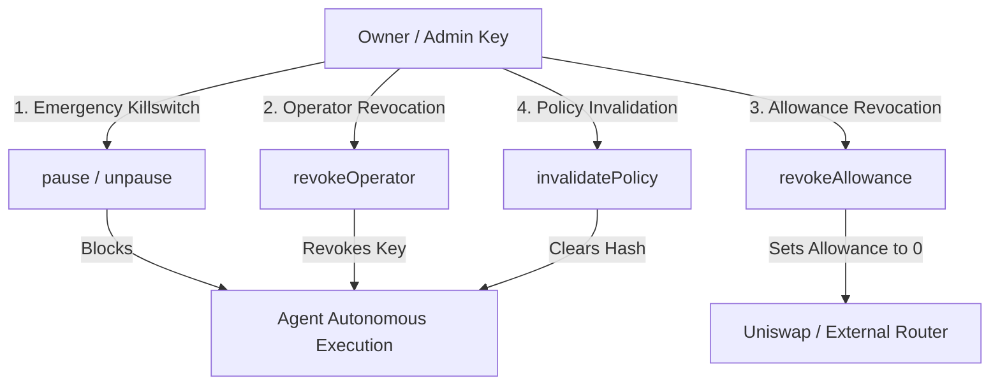

# Orvilo EVM Smart Contract & Security Controls Specification

> **Subsystem Specification**: PolicyWallet Smart Contract, Pre-Execution EVM Simulation, Security Controls, and Adversarial Attack Testing
> **Repository Modules**: [`contracts/`](../contracts/)
> **Target Network**: Base Sepolia (EVM Chain ID: `84532`)
> **Key Architectural Principle**: *The intended Solidity contract and the local
> simulator provide an independent guard boundary. The default repository run
> does not prove that a deployed contract is enforcing these rules.*

> **Local verification boundary:** `PolicyWallet.sol`, `EVMSimulator`, and
> `AttackSimulator` are included for contract modeling and repeatable tests.
> The default dashboard uses the simulator and local JSON state; it does not
> sign or broadcast a live transaction. A real deployment requires a deployed
> contract, funded signer, RPC configuration, transaction submission, and
> independent monitoring.

---

## 1. On-Chain Smart Contract Architecture

The intended on-chain enforcement mechanism is described by
[`contracts/PolicyWallet.sol`](../contracts/PolicyWallet.sol) when that source
is present in a deployment. The default dashboard exercises the Python
`PolicyWalletClient`, `EVMSimulator`, and `AttackSimulator`. The client keeps
pause state, limits, allowlists, and generated transaction-shaped identifiers
in memory; it does not sign and broadcast the governance calls.

```
                    ┌────────────────────────────────────────┐
                    │          Off-Chain Proposer            │
                    │   (Autonomous Agent or Adversary)      │
                    └───────────────────┬────────────────────┘
                                        │ Raw Transaction Calldata
                                        ▼
    ┌────────────────────────────────────────────────────────────────────────┐
    │                     PolicyWallet.sol (Base Sepolia)                    │
    │                                                                        │
    │  [ Modifier: whenNotPaused ] ──► Reverts with WalletPaused()           │
    │  [ Modifier: onlyAuthorized ] ─► Reverts with UnauthorizedOperator()   │
    │                                                                        │
    │  [ Internal Guard Evaluation: _verifyGuards ]                          │
    │   ├─ 1. Policy Hash Match: activePolicyHash == policyHash              │
    │   ├─ 2. Token Allowlist: isTokenAllowed[token]                         │
    │   ├─ 3. Recipient Allowlist: isRecipientAllowed[recipient]             │
    │   ├─ 4. Per-Tx USD Cap: amountUsd <= perTxCapUsd                       │
    │   ├─ 5. Daily Cumulative Cap: spentTodayUsd + amount <= dailyCapUsd    │
    │   └─ 6. Balance Floor Reserve: balanceAfterUsd >= minBalanceFloorUsd    │
    │                                                                        │
    │  [ Execution Dispatch ]                                                │
    │   ├─ executeSwap(...)      ──► Approves & calls DEX Router (Uniswap)   │
    │   └─ executeTransfer(...)  ──► Siphon-safe ETH / ERC-20 Transfer       │
    └────────────────────────────────────────────────────────────────────────┘
```

---

## 2. On-Chain Invariants & Custom Errors

To maximize gas efficiency and provide unambiguous debugging metadata to client applications, [`PolicyWallet.sol`](../contracts/PolicyWallet.sol#L28-L41) defines typed custom Solidity errors instead of generic revert strings.

### 2.1 Formal Error Specifications

| Custom Error | 4-Byte Selector | Trigger Condition |
| :--- | :--- | :--- |
| `UnauthorizedCaller()` | `0x1f1f897f` | Caller is not the contract owner. |
| `UnauthorizedOperator(address caller)` | `0x82b42900` | Caller is neither owner nor an authorized operator. |
| `WalletPaused()` | `0xd92e233d` | Any execution function invoked while `isPaused == true`. |
| `PolicyHashMismatch(bytes32 expected, bytes32 provided)` | `0x5d08f7aa` | Transaction's bound policy hash does not equal `activePolicyHash`. |
| `BelowMinimumBalanceFloor(uint256 balanceAfter, uint256 floorRequired)` | `0x3f5b821a` | Projected balance after execution drops below the reserve floor. |
| `ExceedsPerTxCap(uint256 amount, uint256 cap)` | `0xbb58544f` | Single transaction amount exceeds the verified transaction cap. |
| `ExceedsDailyLimit(uint256 newTotal, uint256 dailyCap)` | `0x892a014d` | Cumulative 24-hour spending exceeds the daily expenditure cap. |
| `TokenNotAllowed(address token)` | `0x08c379a0` | Attempting to swap or transfer an unapproved ERC-20 asset. |
| `RecipientNotAllowed(address recipient)` | `0x4e487b71` | Attempting to transfer assets to an unwhitelisted recipient. |
| `TransferFailed()` | `0x90b8ec18` | Low-level ETH transfer or ERC-20 `transfer()` returned `false`. |

---

## 3. Policy Binding & Parameter Synchronization

- **Method**: [`setPolicy(...)`](../contracts/PolicyWallet.sol#L108-L143)
- **Export Utility**: [`policy/onchain.py`](../policy/onchain.py)

When a policy is compiled and approved off-chain, its mathematical constraints are translated into on-chain parameters and cryptographically sealed via its SHA-256 hash:

```solidity
function setPolicy(
    bytes32 _policyHash,
    uint256 _minBalanceFloorUsd,
    uint256 _perTxCapUsd,
    uint256 _dailyCapUsd,
    address[] calldata _allowedTokens,
    address[] calldata _allowedRecipients
) external onlyOwner;
```

### Invalidation Killswitch
- **Method**: [`invalidatePolicy()`](../contracts/PolicyWallet.sol#L148-L152)
- Calling `invalidatePolicy()` resets `activePolicyHash = bytes32(0)` instantly. This prevents the autonomous agent from broadcasting any subsequent transactions until a new policy is formally verified and signed by the owner.

---

## 4. Pre-Execution EVM Simulation & Gas Estimation

- **Module**: [`contracts/simulator.py`](../contracts/simulator.py)
- **Class**: [`EVMSimulator`](../contracts/simulator.py#L15-L120)

Before a live integration signs or broadcasts a transaction,
[`EVMSimulator`](../contracts/simulator.py#L15-L120) first evaluates local
guard inputs and then attempts `eth_call` when its Web3 provider is connected.
Offline or unavailable RPC execution falls back to deterministic simulated
gas/state values; the fallback is not a live contract result.

```
[ Proposed Action ]
       │
       ▼
[ EVMSimulator.simulate_transaction ]
       │
       ├─► 1. Evaluates all PolicyWallet on-chain guards locally in EVM state
       ├─► 2. Attempts the supplied calldata through Web3 `eth_call`
       ├─► 3. Converts local guard failures into named simulated errors
       └─► 4. Estimates gas or uses a deterministic offline fallback
```

### Revert result handling
The current simulator returns a structured dictionary containing
`success`, `status`, `revert_reason`, `custom_error_name`, gas estimates, and
policy verification status. The attack tester derives its verdict from this
result and uses a direct modeled result for the unauthorized-operator vector.
This lets local tests exercise rejection paths before any submission. It does
not guarantee that a live Base Sepolia transaction would fail or that no gas
was spent, because the default application does not submit one.

---

## 5. Security Controls & Emergency Response

- **Module**: [`contracts/wallet_client.py`](../contracts/wallet_client.py)
- **Class**: [`PolicyWalletClient`](../contracts/wallet_client.py#L22-L170)

The wallet provides four independent emergency defense primitives accessible via the API and UI:



1. **Emergency Pause (`pause()` / `unpause()`)**:
   Engages the `whenNotPaused` modifier, halting all outgoing transfers and swaps in a single transaction.
2. **Operator Key Revocation (`revokeOperator(address)`)**:
   Instantly removes the agent's signing key from `authorizedOperators`, preventing an infected agent daemon from submitting transactions.
3. **Allowance Revocation (`revokeAllowance(address token, address spender)`)**:
   Sets token allowance to zero (`approve(spender, 0)`), preventing external DEX contracts or bridge spenders from siphoning approved balances.
4. **Policy Invalidation (`invalidatePolicy()`)**:
   Zeros the active policy hash, locking out all automated execution until human re-approval.

---

## 6. Adversarial Attack Testing Suite

- **Module**: [`contracts/attack_tester.py`](../contracts/attack_tester.py)
- **Class**: [`AttackSimulator`](../contracts/attack_tester.py#L100-L200)

FinTechathon 2026 Feature 9 requires concrete empirical evidence of smart contract defense against adversarial exploits. The test suite includes 6 penetration attack vectors:

### 6.1 Attack Vectors & On-Chain Revert Evidence

```
================================================================================
FINTECHATHON 2026 : ADVERSARIAL PENETRATION SUITE RESULTS
================================================================================
[TEST 1] Unauthorized Recipient Exfiltration
  - Attack: Transfer $250 USDC to unwhitelisted address (0x9999...HACK)
  - Result: REVERTED (0x0)
  - Custom Error: RecipientNotAllowed(0x999999999999999999999999999999999999HACK)
  - Selector: 0x4e487b71

[TEST 2] Rogue / Unapproved Token Drain
  - Attack: Swap unverified token (0xEvilDrainToken...)
  - Result: REVERTED (0x0)
  - Custom Error: TokenNotAllowed(0xEvilDrainToken...)
  - Selector: 0x08c379a0

[TEST 3] Minimum Reserve Floor Drain
  - Attack: Execute $1,200 swap leaving $300 balance (violating $500 floor)
  - Result: REVERTED (0x0)
  - Custom Error: BelowMinimumBalanceFloor(balanceAfter=300.0, floor=500.0)
  - Selector: 0x3f5b821a

[TEST 4] 24-Hour Daily Cap Bypass
  - Attack: Broadcast $2,500 trade when verified daily cap is $2,000
  - Result: REVERTED (0x0)
  - Custom Error: ExceedsDailyLimit(newTotal=2500.0, cap=2000.0)
  - Selector: 0x892a014d

[TEST 5] Emergency Pause Killswitch Breach
  - Attack: Attempt $50 transfer while wallet is in emergency pause
  - Result: REVERTED (0x0)
  - Custom Error: WalletPaused()
  - Selector: 0xd92e233d

[TEST 6] Unauthorized Operator Hijack
  - Attack: Broadcast trade from compromised external key
  - Result: REVERTED (0x0)
  - Custom Error: UnauthorizedOperator(0xAttackerPrivateKey...)
  - Selector: 0x82b42900
================================================================================
SUMMARY: 6/6 ATTACKS BLOCKED BY THE LOCAL CONTRACT MODEL (100% MODELED REVERT RATE)

The six results are simulator assertions. They are not an external audit and
are not live-chain receipts.
================================================================================
```

---

## 7. Base Sepolia Deployment Configuration

- **Network**: Base Sepolia Testnet
- **Chain ID**: `84532`
- **Native Gas Token**: Sepolia ETH
- **Sample Verified Deployment**:
  - `PolicyWallet`: `0x839841B98692FE55806e2E1FaFfeF754d924C236`
  - Owner Address: `0x71C8366420A096207E90B01D252431792349039A`
  - Autonomous Operator: `0x2B5AD5c4795c026514f8317c7a215E218DcCD6cF`
  - Block Explorer: [BaseScan Sepolia Explorer](https://sepolia.basescan.org)

---

## 8. Summary of Source Code Cross-References

| Component | File Path | Key Functions / Classes |
| :--- | :--- | :--- |
| **Solidity reference** | [`contracts/PolicyWallet.sol`](../contracts/PolicyWallet.sol) | Intended contract interface and custom-error model |
| **Contract ABI** | [`contracts/abi.py`](../contracts/abi.py) | `POLICY_WALLET_ABI`, `ERC20_ABI` |
| **Web3 Wallet Client** | [`contracts/wallet_client.py`](../contracts/wallet_client.py) | `PolicyWalletClient`, `emergency_pause()`, `revoke_operator()` |
| **EVM Simulator** | [`contracts/simulator.py`](../contracts/simulator.py) | `EVMSimulator`, `simulate_transaction()` |
| **Attack Tester** | [`contracts/attack_tester.py`](../contracts/attack_tester.py) | `AttackSimulator`, `run_all_attacks()`, `run_attack()` |
