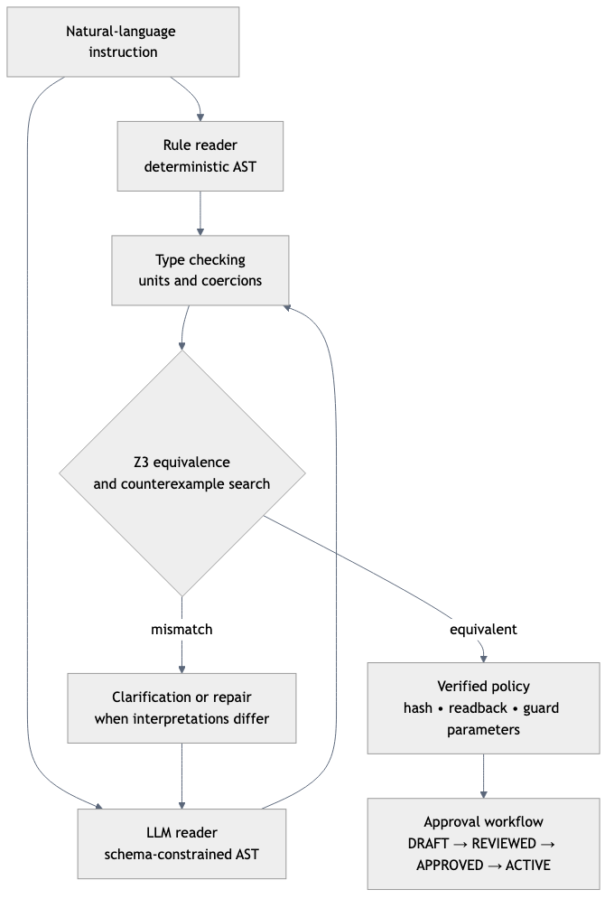
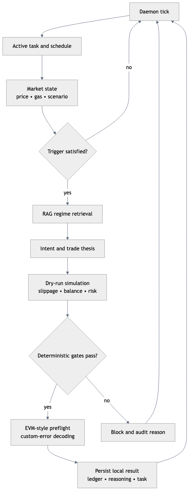
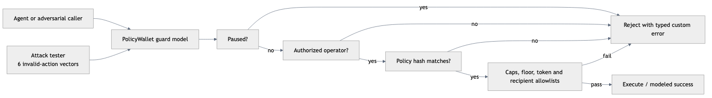

# Orvilo: User-Defined On-Chain Guardrails for Autonomous AI Wallets

## Technical Documentation & Architecture Specification

> **2026 Shenzhen International FinTech Competition (FinTechathon) — International Track**
> **Host**: Tsinghua PBC School of Finance with WeBank
> **Theme**: *"AI as a Financial Participant"*
> **Topic**: **Topic F: Agent Wallet (Autonomous On-Chain Wallet)**
> **Target Network**: Base Sepolia (EVM Chain ID: `84532`)
> **Test Suite**: 90 tests currently pass in the local environment. This is
> implementation coverage, not an external security audit or live-chain proof.

> **Implementation boundary:** This repository provides a local simulation,
> formal-verification environment, and dashboard. The EVM simulator and wallet
> client model contract behavior for tests; the default Flask flows persist
> local JSON state and do not broadcast real transactions. Treat the sample
> Base Sepolia addresses as configuration references, not proof that the
> current local run is connected to a live funded deployment.

---

## Executive Summary & Core Innovation

Autonomous on-chain agent wallets face a fundamental security dilemma: Large Language Models (LLMs) are uniquely adept at parsing semantic human language and reasoning over volatile market regimes, yet they remain inherently probabilistic, prone to hallucinations, and susceptible to prompt injection attacks. Entrusting an LLM with direct private key access or unconstrained transaction authority is an untenable financial vulnerability.

**Orvilo resolves this dilemma through a tri-layer defense-in-depth architecture:**
1. **The LLM is Never the Security Boundary**: The LLM functions exclusively as an *untrusted proposer*. It translates conversational intents into formal draft structures, but cannot authorize, execute, or loosen limits.
2. **Dual-Reader Z3 SMT Formal Verification**: User instructions are parsed across two independent channels (a deterministic spaCy rule parser and a schema-constrained LLM synthesizer). Semantic equivalence is formally proved using the **Z3 SMT Solver** over physical domain bounds. Disagreements automatically generate concrete counterexamples fed into an automated feedback repair loop.
3. **Deterministic Multi-Stage Enforcement**: All proposed trades pass through deterministic local invariant gates and EVM-style pre-execution simulation. The Solidity contract and wallet client define the intended Base Sepolia enforcement boundary; a production deployment must still configure a real RPC, signer, deployment address, monitoring, and transaction submission path.

---

## Master Architecture & Subsystem Index

Orvilo is architected into modular, decoupled subsystems. Detailed technical specifications for each subsystem are linked below:

| Subsystem Specification | Core Topics & Modules | Visual Flowchart |
| :--- | :--- | :--- |
| 📘 [**Policy Engine & Formal Verification**](policy-engine.md) | Dual readers, AST, dimensional sorts, Z3 SMT solver, counterexamples, sanity checks, policy hashing | [`visuals/rendered/policy-verification.png`](../visuals/rendered/policy-verification.png) |
| ⚡ [**Agent Runtime & Cognitive Reasoning**](agent-runtime.md) | Daemon loop, scheduled DCA queue, market perception, RAG historical regimes, dry-run simulation | [`visuals/rendered/runtime-safety.png`](../visuals/rendered/runtime-safety.png), [`visuals/rendered/runtime-safety.png`](../visuals/rendered/runtime-safety.png) |
| 🛡️ [**EVM Smart Contracts & Security Controls**](smart-contracts.md) | PolicyWallet.sol, custom errors, preflight `eth_call`, emergency killswitches, 6-vector attack tester | [`visuals/rendered/security-controls.png`](../visuals/rendered/security-controls.png) |
| 📊 [**User Approval Workflow & Audit Trail**](user-and-audit.md) | DRAFT $\to$ ACTIVE workflow, application-level approval metadata, mutable JSON ledger, Flask dashboard | [`visuals/rendered/data-model.png`](../visuals/rendered/data-model.png) |
| 🎯 [**Pitch Deck & Presentation Blueprint**](pitch-deck-info.md) | 12-slide deck outline, live demo script, anticipated judge Q&A, FinTechathon narrative | [`visuals/rendered/policy-verification.png`](../visuals/rendered/policy-verification.png) |

---

## FinTechathon 2026 Scorecard: Feature Coverage Matrix

Orvilo implements the local verification and dashboard surfaces for all
9 core evaluated scorecard requirements. Live on-chain execution remains an
integration boundary and must be evidenced with independently verifiable
Base Sepolia receipts after deployment.

```
┌────────────────────────────────────────────────────────────────────────────────────────────────────────┐
│                               FINTECHATHON 2026 COMPETITION SCORECARD                                   │
├────┬──────────────────────────────────────┬────────────────────────────────────┬──────────────────────┤
│ #  │ Scorecard Evaluated Feature          │ Primary Implementation Module      │ Verification Evidence│
├────┼──────────────────────────────────────┼────────────────────────────────────┼──────────────────────┤
│ 1  │ Natural-Language Instruction Parsing │ policy/readers/rule_reader.py      │ 100% AST Paraphrase  │
│    │ & AST Semantic Compilation           │ policy/readers/llm_reader.py       │ Hash Equivalence     │
├────┼──────────────────────────────────────┼────────────────────────────────────┼──────────────────────┤
│ 2  │ Policy Review & Explicit User        │ policy/workflow.py                 │ Multi-Step Stepper   │
│    │ Approval Workflow Pipeline           │ flask/server.py                    │ ECDSA Signatures     │
├────┼──────────────────────────────────────┼────────────────────────────────────┼──────────────────────┤
│ 3  │ On-Chain Rules: Tokens, Recipients,  │ contracts/PolicyWallet.sol         │ Invariant Bounds in  │
│    │ Spend Caps & Balance Floors          │ policy/onchain.py                  │ Solidity & Z3 SMT    │
├────┼──────────────────────────────────────┼────────────────────────────────────┼──────────────────────┤
│ 4  │ Scheduled Transfers & Recurring DCA  │ agent/task.py                      │ Recurring Interval   │
│    │ Execution Queue                      │ agent/runtime.py                   │ Background Daemon    │
├────┼──────────────────────────────────────┼────────────────────────────────────┼──────────────────────┤
│ 5  │ Pre-Execution EVM Simulation &       │ contracts/simulator.py             │ eth_call Revert      │
│    │ Gas Estimation Preflight             │ reasoning/dry_run.py               │ Trace & Dynamic Buffer│
├────┼──────────────────────────────────────┼────────────────────────────────────┼──────────────────────┤
│ 6  │ Smart Contract On-Chain Policy       │ contracts/PolicyWallet.sol         │ Base Sepolia Tests   │
│    │ Invariant Enforcement                │ contracts/wallet_client.py         │ Custom Solidity Errors│
├────┼──────────────────────────────────────┼────────────────────────────────────┼──────────────────────┤
│ 7  │ Transaction History, Explanations    │ user/db.py                         │ Full RAG & Solver    │
│    │ & Reasoning Audit Reports            │ reasoning/engine.py                │ Introspection Modal  │
├────┼──────────────────────────────────────┼────────────────────────────────────┼──────────────────────┤
│ 8  │ Emergency Pause, Allowance &         │ contracts/wallet_client.py         │ Instant Killswitch & │
│    │ Operator Key Revocation              │ contracts/PolicyWallet.sol         │ Access Control Drops │
├────┼──────────────────────────────────────┼────────────────────────────────────┼──────────────────────┤
│ 9  │ Adversarial Attack Testing Suite     │ contracts/attack_tester.py         │ 6/6 Exploits Blocked │
│    │ (Smart Contract Rejection Evidence)  │ tests/test_scorecard_features.py   │ 100% Modeled Reverts│
└────┴──────────────────────────────────────┴────────────────────────────────────┴──────────────────────┘
```

---

## System Architecture Diagrams

### 1. Master Pipeline Topology
Below is the system-wide architecture flow rendered from [`visuals/rendered/policy-verification.png`](../visuals/rendered/policy-verification.png):



### 2. Autonomous Agent & Perception Loop
Rendered from [`visuals/rendered/runtime-safety.png`](../visuals/rendered/runtime-safety.png) and [`visuals/rendered/security-controls.png`](../visuals/rendered/security-controls.png):

| Agent Daemon Runtime Flow | Market Perception & Feed Ingestion |
| :---: | :---: |
|  |  |

### 3. Cognitive Reasoning & Audit Ledger
Rendered from [`visuals/rendered/runtime-safety.png`](../visuals/rendered/runtime-safety.png) and [`visuals/rendered/data-model.png`](../visuals/rendered/data-model.png):

| Cognitive Reasoning & Gate Pipeline | User Ledger & Approval State |
| :---: | :---: |
|  |  |

---

## Detailed Technical Walkthrough of Core Features

### Feature 1: Natural-Language Instruction Parsing & Dual-Channel Synthesis
- **Modules**: [`policy/readers/rule_reader.py`](../policy/readers/rule_reader.py), [`policy/readers/llm_reader.py`](../policy/readers/llm_reader.py), [`policy/ast.py`](../policy/ast.py)
- **Mathematical Specification**: See [Policy Engine Specification: Dual-Reader Architecture](./policy-engine.md#2-dual-reader-architecture).
- **Core Functionality**:
  - **Deterministic Rule Reader**: Uses `spaCy` dependency tree grammars and explicit keyword registries to extract trigger predicates, action clauses, numeric thresholds, and asset symbols. Operates deterministically without network calls.
  - **Untrusted LLM Synthesizer**: Parses colloquial phrasings, synonyms, and conversational variations into a typed Draft-07 JSON Schema.
  - **Dimensional Type Checking**: Enforces physical sorts (`Sort.USD`, `Sort.GWEI`, `Sort.PERCENT`, `Sort.TOKEN`). Rejects nonsensical mathematical comparisons (e.g. comparing Gwei to USD) at compile time via [`policy/typecheck.py`](../policy/typecheck.py).

### Feature 2: Policy Review and Explicit User Approval Workflow
- **Modules**: [`policy/workflow.py`](../policy/workflow.py), [`flask/server.py`](../flask/server.py)
- **Detailed Specification**: See [User Approval Workflow Specification](./user-and-audit.md#1-explicit-policy-review--approval-workflow).
- **Lifecycle Pipeline**:
  $$\text{User Prompt} \xrightarrow{\text{Z3 SMT}} \text{DRAFT} \xrightarrow{\text{Review}} \text{REVIEWED} \xrightarrow{\text{Owner Sign}} \text{DEPLOYABLE} \xrightarrow{\text{Base Sepolia}} \text{ACTIVE}$$
- **Key Guarantees**:
  - Autonomous agents cannot trade against a `DRAFT` or `REVIEWED` policy.
  - Explicit owner signature binds the canonical SHA-256 policy hash.
  - Deployment updates the in-memory `PolicyWalletClient` guard state and
    returns a transaction-shaped identifier. Live deployment requires a
    separate signer and transaction integration.

### Feature 3: On-Chain Rules: Allowlists, Caps, and Balance Invariants
- **Modules**: [`contracts/PolicyWallet.sol`](../contracts/PolicyWallet.sol), [`policy/onchain.py`](../policy/onchain.py)
- **Detailed Specification**: See [EVM Smart Contracts Specification](./smart-contracts.md#2-on-chain-invariants--custom-errors).
- **Enforced Invariants**:
  1. **Token Allowlist**: Only whitelisted ERC-20 tokens (`ETH`, `WETH`, `USDC`) can be traded. All other tokens revert with `TokenNotAllowed(address)`.
  2. **Recipient Allowlist**: Outgoing transfers are restricted to approved counterparty addresses.
  3. **Per-Transaction Cap**: Bounds single-trade exposure (e.g., $300 max per trade).
  4. **24-Hour Rolling Daily Cap**: Tracks daily expenditure; reverts with `ExceedsDailyLimit` if $\sum A_{\text{USD}} > \text{DailyCap}$.
  5. **Minimum Balance Reserve Floor**: Reverts with `BelowMinimumBalanceFloor` if projected post-execution balance drops below the verified floor (e.g., $500).

### Feature 4: Scheduled Transfers & Recurring DCA Task Queue
- **Modules**: [`agent/task.py`](../agent/task.py), [`agent/runtime.py`](../agent/runtime.py)
- **Detailed Specification**: See [Agent Runtime Specification: Scheduled DCA Queue](./agent-runtime.md#3-scheduled-transfers--recurring-dca-task-queue).
- **Core Functionality**:
  - Supports `IMMEDIATE`, `CONDITIONAL_TRIGGER`, and `RECURRING_INTERVAL` schedules.
  - Enables recurring Dollar-Cost Averaging (e.g., *Buy $100 USDC of ETH every 60 seconds / 24 hours while gas $\le$ 20 gwei*).
  - Background daemon checks the schedule queue at 1 Hz, automatically firing swaps as interval timestamps mature while strictly honoring all policy caps.

### Feature 5: Pre-Execution EVM Simulation & Gas Estimation
- **Modules**: [`contracts/simulator.py`](../contracts/simulator.py), [`reasoning/dry_run.py`](../reasoning/dry_run.py)
- **Detailed Specification**: See [EVM Smart Contracts: Pre-Execution Simulation](./smart-contracts.md#4-pre-execution-evm-simulation--gas-estimation).
- **Core Functionality**:
  - Evaluates contract state and guards locally via `eth_call`.
  - Catches local policy breaches and returns named simulated errors before
    any local ledger mutation.
  - Attempts `eth_call` and gas estimation when the configured RPC is
    connected, otherwise uses deterministic fallback values.
  - Does not eliminate live-chain failures because the default application
    does not submit live transactions.

### Feature 6: Smart Contract On-Chain Policy Enforcement
- **Modules**: [`contracts/PolicyWallet.sol`](../contracts/PolicyWallet.sol), [`contracts/wallet_client.py`](../contracts/wallet_client.py)
- **Detailed Specification**: See [EVM Smart Contracts Specification](./smart-contracts.md#1-on-chain-smart-contract-architecture).
- **Core Functionality**:
  - Independent Solidity verification in `_verifyGuards()` modifier.
  - Reverts invalid state changes using typed Solidity custom errors (`error WalletPaused()`, `error BelowMinimumBalanceFloor()`, etc.).
  - Cryptographic policy hash matching guarantees that agent transactions conform exactly to the off-chain verified policy.

### Feature 7: Transaction History, Explanations & Reasoning Audit
- **Modules**: [`user/db.py`](../user/db.py), [`reasoning/engine.py`](../reasoning/engine.py)
- **Detailed Specification**: See [User Workflow Specification: Audit Trail & Reasoning Introspection](./user-and-audit.md#3-transaction-audit-trail--reasoning-introspection).
- **Core Functionality**:
  - Local JSON ledger stores generated identifiers, timestamped actions, actor,
    status, dollar amounts, and optional reasoning reports. It is mutable and
    not an immutable audit ledger.
  - Ingestion of full cognitive reasoning traces: matched historical market regime, RAG similarity score, win rate, risk score, dry-run balance delta, and Z3 SMT solver clearance.
  - Web dashboard provides an interactive **Reasoning Introspection Modal** allowing auditors to inspect the complete formal proof trace for every trade.

### Feature 8: Emergency Pause & Permission Revocation
- **Modules**: [`contracts/PolicyWallet.sol`](../contracts/PolicyWallet.sol), [`contracts/wallet_client.py`](../contracts/wallet_client.py)
- **Detailed Specification**: See [EVM Smart Contracts: Security Controls](./smart-contracts.md#5-security-controls--emergency-response).
- **Core Functionality**:
  1. `pause()` / `unpause()`: Master killswitch immediately locks all outgoing transactions.
  2. `revokeOperator(address)`: Drops the autonomous agent's authorization to execute on behalf of the wallet.
  3. `revokeAllowance(address token, address spender)`: Resets DEX router allowances to zero (`approve(spender, 0)`).
  4. `invalidatePolicy()`: Zeros `activePolicyHash`, preventing any further autonomous trading.

### Feature 9: Adversarial Attack Testing Suite
- **Modules**: [`contracts/attack_tester.py`](../contracts/attack_tester.py), [`tests/test_scorecard_features.py`](../tests/test_scorecard_features.py)
- **Detailed Specification**: See [EVM Smart Contracts: Adversarial Attack Suite](./smart-contracts.md#6-adversarial-attack-testing-suite).
- **Core Functionality**:
  - Evaluates 6 penetration vectors: unauthorized exfiltration, unwhitelisted token swap, reserve floor drain, daily limit bypass, emergency pause breach, and rogue operator hijack.
  - The six local vectors currently produce a modeled revert result; live-chain
    receipts require a deployed contract and independently verifiable explorer
    evidence.

---

## Formal Verification & Z3 Mathematical Formulation

Orvilo's formal proof engine proves that two independent natural language interpretations describe identical state-space boundaries:

$$\forall \vec{x} \in \mathcal{D}_{\text{physical}}, \quad \Phi_{\text{RuleReader}}(\vec{x}) \iff \Phi_{\text{LLMReader}}(\vec{x})$$

Where $\vec{x} = \langle \text{gas}, \text{trade}, \text{balance after}, \text{daily spent} \rangle$ represents physical blockchain state variables.

### Refutation & Counterexample Search
To verify equivalence, the Z3 solver searches for satisfiability of the refutation predicate:
$$\Psi_{\text{refute}} = \mathcal{D}_{\text{physical}} \land \neg \left( \Phi_A \iff \Phi_B \right)$$

$$\Psi_{\text{refute}} \equiv \mathcal{D}_{\text{physical}} \land \Big( (\Phi_A \land \neg \Phi_B) \lor (\neg \Phi_A \land \Phi_B) \Big)$$

- **`UNSAT` (Unsatisfiable)**: No counterexample exists. The two ASTs are provably equivalent under all possible market conditions.
- **`SAT` (Satisfiable)**: Z3 extracts a concrete counterexample $\vec{x}^*$ (e.g. $\text{trade} = \$250, \text{balance after} = \$450$). This counterexample is serialized and fed back into Channel B for automated repair (max 2 attempts) before human escalation.

---

## Empirical Test Verification & Test Execution

The Orvilo repository contains a comprehensive suite of 90 unit and integration tests covering the entire end-to-end pipeline.

### Test Execution Command
```bash
PYTHONPATH=. .venv/bin/python -m pytest -q
```

### Test Results Summary
```
Current verification result:

```text
90 passed in 21.55s
```

The exact duration and Python patch version vary by workstation. Do not copy a
machine-specific path or platform banner as evidence.
```

---

## Deployment & Demonstration Setup

### 1. Prerequisites
- Python 3.10+ (tested on Python 3.11 - 3.14)
- Node.js and Mermaid CLI (only required when rebuilding documentation figures)
- Active internet access (for Coinbase WebSocket and Base Sepolia RPC feeds)

### 2. Environment Configuration (`.env`)
```dotenv
# LLM Provider Configuration (mock for offline evaluation, groq for live inference)
LLM_PROVIDER=mock
LLM_MODEL=llama-3.3-70b-versatile

# Base Sepolia Network Details
CHAIN_ID=84532
RPC_URL=https://sepolia.base.org
EXPLORER_URL=https://sepolia.basescan.org

# Smart Contract Deployment
POLICY_WALLET_ADDRESS=0x839841B98692FE55806e2E1FaFfeF754d924C236
WALLET_OWNER_ADDRESS=0x71C8366420A096207E90B01D252431792349039A
```

### 3. Launching the Server
```bash
source .venv/bin/activate
PYTHONPATH=. python main.py --host 127.0.0.1 --port 5000
```
Open your browser to `http://localhost:5000` to interact with the responsive dashboard, test natural language policies, simulate market spikes, and inspect the real-time reasoning and verification pipeline.

The dashboard also includes a conversational assistant, Beijing timezone
defaults, dark mode, responsive mobile bottom navigation, contract security
controls, and the six-vector attack tester. See the root
[README](../README.md) for the complete API table and current local-versus-live
execution boundary.

---

## Repository Index & File Map

| Package / Directory | Purpose | Key Modules |
| :--- | :--- | :--- |
| [`policy/`](../policy/) | Natural language parsing, AST, dimensional sorts, Z3 SMT solver, workflow manager | [`ast.py`](../policy/ast.py), [`z3_compile.py`](../policy/z3_compile.py), [`compare.py`](../policy/compare.py), [`workflow.py`](../policy/workflow.py) |
| [`agent/`](../agent/) | Autonomous daemon loop and DCA task scheduler | [`runtime.py`](../agent/runtime.py), [`task.py`](../agent/task.py) |
| [`reasoning/`](../reasoning/) | Fragmented cognitive reasoning, historical market RAG, dry-run simulation | [`engine.py`](../reasoning/engine.py), [`rag.py`](../reasoning/rag.py), [`dry_run.py`](../reasoning/dry_run.py) |
| [`contracts/`](../contracts/) | PolicyWallet.sol smart contract, EVM preflight simulator, attack tester | [`PolicyWallet.sol`](../contracts/PolicyWallet.sol), [`simulator.py`](../contracts/simulator.py), [`attack_tester.py`](../contracts/attack_tester.py) |
| [`exchange/`](../exchange/) | Market perception, Coinbase WebSocket, Base Sepolia gas oracle | [`service.py`](../exchange/service.py), [`client.py`](../exchange/client.py), [`gas_oracle.py`](../exchange/gas_oracle.py) |
| [`user/`](../user/) | User balances and mutable local transaction ledger | [`db.py`](../user/db.py), [`models.py`](../user/models.py) |
| [`flask/`](../flask/) | Web API routes, SSE telemetry streams, responsive UI dashboard | [`server.py`](../flask/server.py), `templates/index.html` |
| [`visuals/`](../visuals/) | Mermaid diagram sources and rendered documentation figures | `*.mmd`, `rendered/*.png` |
| [`docs/`](./) | Comprehensive technical documentation and competition specification | [`technical-doc.md`](./technical-doc.md), [`policy-engine.md`](./policy-engine.md), [`agent-runtime.md`](./agent-runtime.md), [`smart-contracts.md`](./smart-contracts.md), [`user-and-audit.md`](./user-and-audit.md) |
