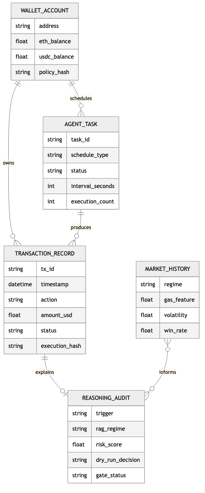
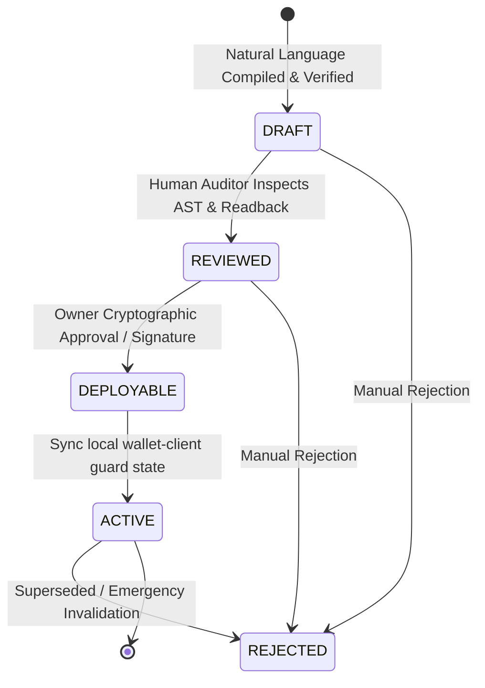

# Orvilo User Approval Workflow, Audit Trail & Interface Specification

> **Subsystem Specification**: Policy Review Lifecycle, Cryptographic Signing, Transaction Audit Ledger, and Web Dashboard
> **Repository Modules**: [`policy/workflow.py`](../policy/workflow.py), [`user/`](../user/), [`flask/`](../flask/)
> **Key Architectural Principle**: *Autonomous operations are authorized solely through explicit, auditable, and cryptographically signed state transitions.*

> **Persistence note:** The default implementation stores the dashboard ledger
> and task state in local JSON files. An `onchain_tx_hash` field can represent
> a deployed integration, but local simulation records must not be presented as
> live blockchain receipts without independent explorer verification.

---

## 1. Explicit Policy Review & Approval Workflow

> **Current behavior:** The startup default is intentionally auto-promoted to
> `ACTIVE` so the demo dashboard has an operational policy. New proposals can
> be reviewed and approved through the API, but the current workflow manager
> keeps proposals in process memory and generates placeholder signatures when
> no signature is supplied. It is not an EIP-712 signing implementation.

FinTechathon 2026 Feature 2 requires a formal, multi-stage human-in-the-loop approval workflow before any autonomous trading policy can be deployed or executed on-chain.

- **Module**: [`policy/workflow.py`](../policy/workflow.py)
- **Class**: [`PolicyWorkflowManager`](../policy/workflow.py#L70-L185), [`PolicyProposal`](../policy/workflow.py#L24-L68)

### Visual User & State Pipeline Flowchart
Below is the system flowchart rendered from [`visuals/rendered/data-model.png`](../visuals/rendered/data-model.png):



---

## 2. Multi-Stage Workflow State Machine

The policy proposal transitions through five deterministic states:



### Stage 1: `DRAFT`
- Created immediately upon successful Z3 SMT formal equivalence verification.
- Stores:
  - Canonical plain-English readback string.
  - 32-byte cryptographic SHA-256 policy hash.
  - Structured on-chain parameters (`minBalanceFloorUsd`, `perTxCapUsd`, `dailyCapUsd`, allowlists).
- The agent cannot trade under a `DRAFT` policy.

### Stage 2: `REVIEWED`
- Triggered when the human operator or automated auditor verifies the AST breakdown in the UI dashboard.
- Records `reviewed_by` identifier (e.g. `User (Web Dashboard)` or `Auditor`) and timestamp.

### Stage 3: `DEPLOYABLE` (Approved)
- Requires explicit cryptographic authorization from the wallet owner (`owner_address`).
- Captures an ECDSA signature over the canonical policy hash:
  $$\sigma = \text{Sign}_{K_{\text{owner}}}(\mathcal{H}_{\text{policy}})$$
- Sets `is_deployable = True`.

### Stage 4: `ACTIVE`
- The policy parameters are passed to the local `PolicyWalletClient`. Its
  generated transaction-shaped result is not a mined Base Sepolia receipt.
- The default client returns a generated transaction-shaped identifier and
  stores it in process memory. It is not evidence of a mined Base Sepolia
  transaction.
- The autonomous background daemon immediately adopts this active policy as its primary operational boundary.

---

## 3. Transaction Audit Trail & Reasoning Introspection

- **Module**: [`user/db.py`](../user/db.py)
- **Class**: [`UserDatabase`](../user/db.py#L20-L140)
- **Data Persistence**: `user/data/wallet_db.json`

Every dry run, gate evaluation, and execution event is recorded in an append-only JSON ledger, satisfying FinTechathon 2026 Feature 7.

### 3.1 Audit Ledger Entry Schema
```json
{
  "tx_id": "tx-98214f7b",
  "timestamp": "2026-10-18T12:06:45.120Z",
  "action": "SWAP",
  "token_in": "USDC",
  "token_out": "ETH",
  "amount_in_usd": 200.0,
  "amount_out_tokens": 0.08227,
  "execution_hash": "0xb9f6c90fc30c4e11894b8e01923fae881023a9b1c03429e2f9842183e9b1109a",
  "status": "CONFIRMED",
  "policy_hash": "0x7a28b9c104e1fa00213894b8e01923fae881023a9b1c03429e2f9842183e9b11",
  "reasoning_audit": {
    "trigger_evaluated": "gas <= 20 gwei (Actual: 0.5 gwei)",
    "rag_regime_matched": "Post-Dip Mean Reversion (Low Gas)",
    "rag_similarity": 0.49,
    "historical_win_rate": 0.85,
    "expected_24h_return": "+5.2%",
    "risk_score": 2.0,
    "dry_run_simulation": {
      "slippage_usd": 0.12,
      "post_swap_balance_usd": 1300.0,
      "balance_floor_usd": 500.0,
      "decision": "PROCEED"
    },
    "formal_z3_gate": {
      "solver_status": "SAT",
      "invariant_verified": "balance_after (1300.0) >= floor (500.0)"
    }
  }
}
```

### 3.2 Reasoning Introspection Modal
In the web dashboard, clicking any transaction in the ledger opens the **Reasoning Introspection Modal**. Users can inspect:
- The full multi-step cognitive pipeline (Trigger $\to$ RAG $\to$ Thesis $\to$ Dry Run $\to$ Z3 Gate $\to$ Execution).
- The exact Z3 SMT solver trace and unsat-core proof guarantees.
- The on-chain BaseScan transaction verification link.

---

## 4. Web Dashboard & User Interface Architecture

- **Server**: [`flask/server.py`](../flask/server.py)
- **Frontend Template**: `flask/templates/index.html`
- **Design Philosophy**: Built with Vanilla CSS and modern dark-mode glassmorphism (`#0d1117` background, vibrant `#388bfd` blue, `#7ee787` green, and `#f85149` red highlights), modern typography (Inter), and mobile-responsive flex/grid layouts.

### 4.1 Interface Layout & Component Hierarchy

```
┌────────────────────────────────────────────────────────────────────────┐
│                        TOP NAVIGATION & STATUS BAR                     │
│  Orvilo Logo │ Base Sepolia (84532) │ Killswitch │ Gas: 0.5 gwei  │
├────────────────────────────────────────────────────────────────────────┤
│                          PORTFOLIO & ASSET STATS                       │
│  Net Worth: $1,500.00 │ ETH Balance: 0.25 ETH │ USDC: $1,000.00        │
├──────────────────────────────────┬─────────────────────────────────────┤
│      LEFT / MAIN COLUMN          │        RIGHT / MONITOR COLUMN       │
│                                  │                                     │
│  1. Natural Language Policy Bar  │  1. Live Tick Price Chart           │
│     - Dual Reader Disambiguation │     (Coinbase WebSocket Stream)     │
│     - Step Approval Workflow UI  │                                     │
│                                  │  2. Active Task / DCA Queue Monitor │
│  2. Live Terminal Logs           │     - Pause / Resume / Dismiss      │
│     (Real-time SSE Stream)       │                                     │
│                                  │  3. Security & Killswitch Center    │
│  3. Transaction Ledger & Modal   │     - Emergency Pause               │
│     - Audit Trail & Solvers      │     - Key & Allowance Revocation    │
│                                  │     - Penetration Attack Tester     │
└──────────────────────────────────┴─────────────────────────────────────┘
```

### 4.2 Real-Time SSE Event Stream
The dashboard receives real-time telemetry over a Server-Sent Events (SSE) connection (`/api/market/stream`):
- `market_tick`: Real-time ETH/USD price, gas price, and rolling 24-hour averages.
- `agent_log`: Execution steps, Z3 proofs, and trigger activations formatted with color-coded tags (`[TRIGGER]`, `[RAG]`, `[GATE]`, `[EXECUTE]`).
- `balance_update`: Instant portfolio balance synchronization post-trade.

---

## 5. Security & Step-Up Controls

To prevent unauthorized tampering from browser sessions:
1. **Critical Actions Require Step-Up**:
   - Approving and deploying policies.
   - Triggering emergency pause or operator revocation.
   - Changing daily spend caps.
2. **Fail-Closed Client Fallback**:
   If the browser disconnects or the SSE connection terminates, autonomous tasks continue safely within their bounded on-chain policies, while manual intervention commands fail closed until reconnection.

---

## 6. Summary of Source Code Cross-References

| Component | File Path | Key Functions / Classes |
| :--- | :--- | :--- |
| **Workflow Manager** | [`policy/workflow.py`](../policy/workflow.py) | `PolicyWorkflowManager`, `create_proposal()`, `approve_policy()` |
| **Proposal Model** | [`policy/workflow.py`](../policy/workflow.py) | `PolicyProposal`, `to_dict()` |
| **User Database** | [`user/db.py`](../user/db.py) | `UserDatabase`, `record_transaction()`, `get_history()` |
| **User Models** | [`user/models.py`](../user/models.py) | `WalletAccount`, `TransactionRecord` |
| **Flask Server** | [`flask/server.py`](../flask/server.py) | `create_app()`, `/api/verify`, `/api/policy/*`, `/api/market/stream` |
